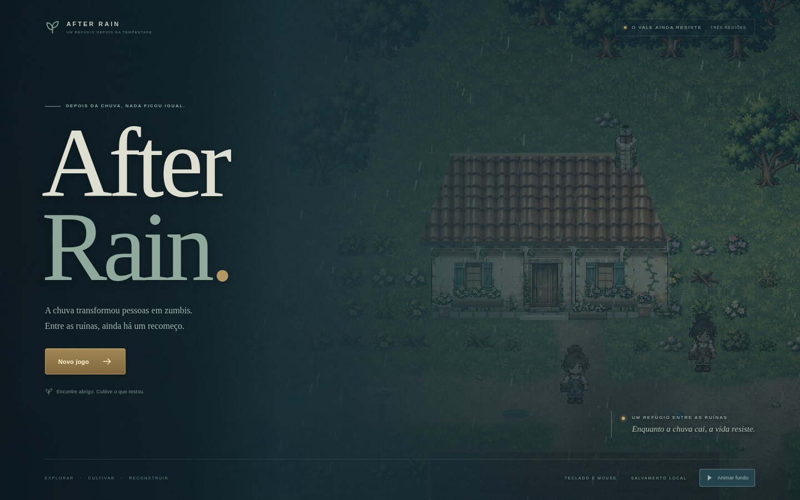
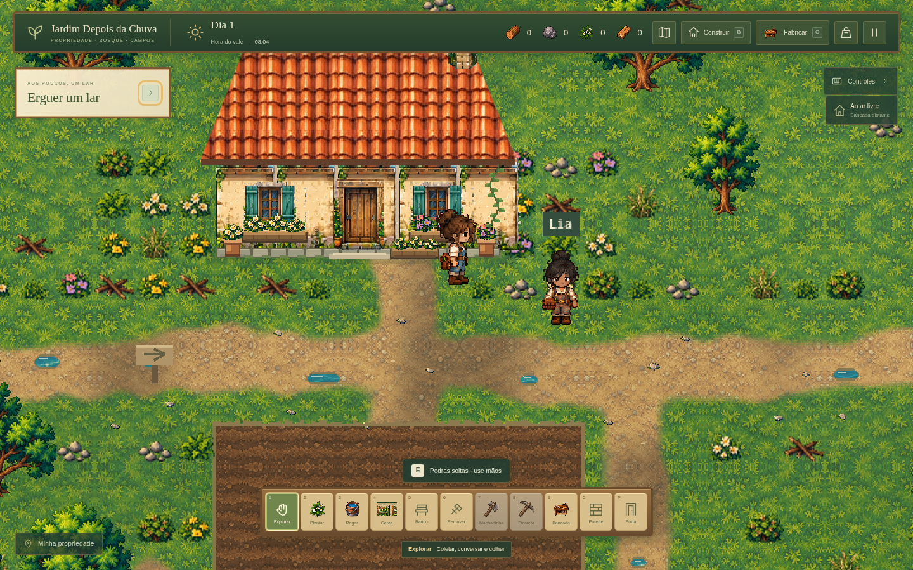

# After Rain

Uma pequena clareira, uma casa que resistiu e a chance de recomeçar. **After Rain**, anteriormente chamado Jardim Depois da Chuva, é um jogo original para navegador, single-player, com exploração, cultivo e construção em pixel art 2D top-down. Sua história se passa após uma chuva que transformou pessoas em zumbis. Continua no mesmo projeto, com TypeScript, Phaser 3 e Vite e aplicativo desktop em Electron.

A versão do código é **0.5.0, em desenvolvimento**. A [nova tela inicial After Rain](docs/tela-inicial-after-rain.md) apresenta a propriedade com garoa, neblina, tons frios e câmera suave, com suporte preparado para vídeo local em loop. O clipe do Flow ainda não foi fornecido; a configuração padrão usa o cenário do jogo. A última versão Windows publicada continua sendo a [0.4.0](docs/versao-windows-v0.4.md), com o nome anterior.



[Sprites de terreno reformulados](docs/terrenos-novos.md): onze materiais originais de grama, bosque, campos, estradas, cultivo, margens, água, madeira e pedra de passagem, acompanhando a arte das árvores.

[Recursos e margens renovados](docs/recursos-e-margens.md): pedras soltas e rochas mineráveis têm silhuetas diferentes, os recursos baixos foram retirados das trilhas e as bordas dos caminhos e da água usam contornos arredondados. O movimento consulta a mesma margem contínua usada no desenho.

O [polimento das pedras decorativas e flores](docs/decoracao-pedras-flores.md) substitui as antigas lajes retangulares por pedras irregulares e traz flores com folhagem detalhada para canteiros, vasos e floreiras, seguindo a mesma arte das árvores e recursos.

O [novo personagem e editor de aparência](docs/personagem-e-criacao.md) usa sprites de 48×64 com três penteados e quatro direções, prévia giratória com caminhada, cores independentes de camisa e macacão, bolsa opcional e aparências prontas. As escolhas persistem no salvamento, com compatibilidade para perfis antigos. As três pedras de passagem em frente à casa foram retiradas.



O mundo continua com a propriedade, o **Bosque do Pinheiro**, a leste, e os **Campos Abertos**, ao sul. A [documentação da expansão 0.2.0](docs/expansao-visual-v0.2.md) registra a criação dessas áreas e a compatibilidade com partidas anteriores.

A documentação recebida está em [LEIA_PRIMEIRO.md](LEIA_PRIMEIRO.md) e [documentacao/](documentacao/). A [Bíblia do jogo](documentacao/01_BIBLIA_DO_JOGO.md) define a direção completa; este README descreve a fatia implementada. As [decisões da vertical slice](docs/decisoes-vertical-slice.md) registram a adaptação das receitas, dos materiais e da construção à base existente.

As [referências visuais](referencias/README.md) e os [quatro pacotes de arte/protótipos](pacotes_existentes/README.md) estão no repositório. Os arquivos usados pela aplicação ficam em `public/assets/`.

## Instalar e abrir

Use Node.js **22.12 ou superior** e npm. Não há backend, serviços pagos, contas ou chaves de API.

```bash
npm ci
npm run dev
```

Abra no navegador o endereço informado pelo Vite, normalmente `http://localhost:5173`. O foco inicial é computador com teclado e mouse. A tela inicial permite começar um jogo e continuar quando há save local válido.

Para conferir e gerar a versão de produção:

```bash
npm run check
npm test
npm run build
npm run preview
```

O build fica em `dist/`. Sirva essa pasta por HTTP; abrir `index.html` diretamente pelo sistema de arquivos não é o fluxo suportado. O Vite 7 requer Node.js 20.19+ ou 22.12+; a versão recomendada acima atende a esse requisito.

## Aplicativo para Windows

**Última versão publicada e verificada:** [Jardim Depois da Chuva v0.4.0 — Windows x64](https://github.com/juniorangel2000-commits/Junior/releases/download/v0.4.0/Depois-da-Chuva-0.4.0-Windows-x64.exe). A [página da Release](https://github.com/juniorangel2000-commits/Junior/releases/tag/v0.4.0) também disponibiliza o executável e seu manifesto de integridade. Inclui todas as melhorias de terreno, recursos, margens, flores, personagem e personalização, além da entrada da casa sem as três pedras de passagem.

O pacote portátil é gerado em `release/`, com nome `After-Rain-<versão>-Windows-x64.exe` a partir da versão 0.5.0. Os pacotes anteriores mantêm o nome de arquivo original. Ele é destinado a **Windows 10/11 de 64 bits**. Para jogar o pacote pronto, abra o `.exe` com dois cliques. Não precisa instalar Node.js, abrir um terminal, manter o Vite ativo, conectar à internet ou executar como administrador. A primeira abertura pode demorar um pouco enquanto o pacote prepara seus arquivos temporários.

O aplicativo usa Electron e inclui o jogo e seu próprio motor de execução. O save fica nos dados locais do usuário, em `%APPDATA%\Depois da Chuva`. Ele é separado do save do navegador e permanece ao fechar o jogo ou mover o executável. A origem interna do jogo permanece fixa entre versões; a pasta temporária do portátil não determina o local do save.

Para reconstruir o executável a partir do código:

```bash
npm ci
npm run desktop:win
```

Para abrir o aplicativo em desenvolvimento, use `npm run desktop`. O empacotamento precisa baixar ferramentas oficiais do Electron e NSIS, mas o aplicativo pronto funciona offline. O código da versão web continua disponível com `npm run dev`.

O pacote não possui assinatura digital de editor. A abertura interativa da nova integração no Windows permanece pendente. O conteúdo da janela não recebe acesso a Node.js e roda com isolamento de contexto e sandbox.

### Distribuição pelo GitHub

O workflow `.github/workflows/windows-release.yml` gera o pacote em um runner Windows. Sua execução manual produz o artefato `After-Rain-Windows-x64`, contendo `.exe` e `SHA256SUMS.txt`. Quando uma tag `v*` é enviada, o workflow publica esses arquivos em uma GitHub Release usando a autorização temporária do GitHub. A versão 0.5.0 ainda não foi publicada.

A [execução da versão v0.4.0](https://github.com/juniorangel2000-commits/Junior/actions/runs/39621761382) concluiu com sucesso em um runner Windows, incluindo TypeScript, 135 testes e empacotamento. O executável publicado foi baixado e conferido: **119.488.181 bytes**, cabeçalhos PE válidos e SHA-256 correspondente ao manifesto público. O hash e os detalhes estão em [versao-windows-v0.4.md](docs/versao-windows-v0.4.md). Caminhos internos como `/workspace/Junior/release/...` não equivalem a links públicos; use a Release para distribuir o pacote.

## Controles

Crie seu personagem escolhendo nome, tom de pele, penteado, cor do cabelo, macacão, camisa e bolsa. Confira as quatro direções e a caminhada na prévia; os presets e o botão de redefinir ajudam a escolher. **Novas partidas começam com a mochila vazia**; recursos básicos ficam perto da casa. Partidas antigas mantêm seu estoque ao migrar.

| Controle | Ação |
| --- | --- |
| WASD ou setas | Caminhar |
| E ou clique esquerdo próximo | Interagir com a ação selecionada |
| 1 | Mãos: coletar, colher, conversar e abrir/fechar porta |
| 2 | Plantar uma semente de nabo |
| 3 | Regar uma planta |
| 4 | Construir uma cerca |
| 5 | Colocar um banco decorativo |
| 6 | Remover uma construção |
| 7 | Usar a machadinha fabricada |
| 8 | Usar a picareta fabricada |
| 9 | Colocar uma bancada |
| 0 | Colocar uma parede |
| P | Colocar uma porta |
| B | Abrir o menu de construção e selecionar peças/projeto |
| R | Girar a cobertura selecionada |
| C | Abrir ou fechar a fabricação |
| I | Abrir ou fechar a mochila |
| M | Abrir ou fechar o mapa das áreas exploráveis |
| Esc | Fechar/cancelar o menu ou pausar |

As ações também podem ser selecionadas pela interface. Interagir e construir exigem proximidade e alvo válido. Use o menu **B** para piso, janela e cobertura, além das demais peças. Menus, fabricação e diálogos pausam movimento, relógio e crescimento. O teclado do jogo não movimenta o personagem durante a digitação do nome.

## Propriedade e exploração

O mundo contínuo tem **96×72 tiles de 32 pixels**: 3.072×2.304 pixels lógicos. A câmera acompanha o personagem e as áreas são percorridas a pé.

| Área | Como chegar | O que há |
| --- | --- | --- |
| Minha propriedade | Ponto inicial | Casa, horta, Lia, lago, ruínas e materiais para começar |
| Bosque do Pinheiro | Siga a trilha a leste e atravesse a ponte | Pinheiros, árvores de corte, pedras, fibras e trilhas |
| Campos Abertos | Siga a trilha ao sul, pela lateral oeste da horta | Recursos, clareiras para construir e uma segunda travessia do rio |

**M** abre um esquema das três áreas com sua posição. A referência artística do mapa expandido também pode ser consultada nesse menu. Ela contém regiões de expansões futuras, como vila e costa; essas regiões ainda não são áreas jogáveis. Coleta, corte, mineração, construção e salvamento funcionam nas três áreas implementadas. A horta cultivável permanece na propriedade.

## Da coleta ao primeiro abrigo

1. Com as mãos, recolha **galhos, pedras e fibras** perto da casa. Há novos pontos fixos desses recursos, inclusive para partidas migradas que já tenham esgotado os pontos antigos.
2. Em **C**, prepare componentes: 3 fibras viram 1 corda, 2 pedras viram 1 pedra lascada, 1 galho vira 1 cabo e 1 galho vira 4 cavilhas.
3. Fabrique **machadinha**, **picareta** e **martelo**. A machadinha usa cabo + pedra lascada + corda; a picareta usa cabo + 2 pedras lascadas + corda; o martelo usa cabo + pedra + corda.
4. Selecione **7** e dê quatro golpes em uma árvore acessível para receber 2 troncos e 3 galhos. Use **8** em um veio de pedra: cinco golpes entregam 4 pedras.
5. Na fabricação, use a machadinha para transformar **1 tronco em 2 tábuas brutas**, em 4 segundos. Você pode fazer isso antes de possuir bancada ou serrote.
6. Prepare 4 tábuas brutas e 4 cavilhas. Com o martelo na mochila, selecione **9** e coloque uma **bancada** em um espaço livre.
7. Recolha sucata nas ruínas a oeste. Perto da bancada, transforme 1 sucata em 1 lâmina; depois, monte o **serrote improvisado** com lâmina + cabo + corda.
8. Com serrote e bancada próxima, **1 tronco vira 3 tábuas regulares**, em 3 segundos. Tábuas brutas e regulares são materiais diferentes. A construção inicial usa tábuas brutas.
9. Abra **B** e construa piso, paredes, janela, porta e cobertura. O abrigo de teste ocupa 3×3 tiles externos: 9 pisos, 6 paredes, 1 porta, 1 janela e 3 coberturas de 1×3. Custa **32 tábuas brutas, 9 cavilhas e 9 fibras**, somando as mesmas peças do modo livre. O martelo e uma bancada próxima são exigidos ao colocar as peças novas.
10. Abra a porta com as mãos, entre no tile central e feche. Com contorno, piso e cobertura completos, o HUD reconhece o abrigo; o telhado se oculta para revelar o interior.
11. Pause e continue pelo menu, ou feche e reabra o jogo. Materiais, ferramentas, recursos trabalhados e construções devem ser recuperados.

O processamento mostra progresso. Cancelar ou fechar antes da conclusão não consome os materiais. Não há fila de produção offline.

A **bancada** é uma estação. O **banco** da tecla 5 continua sendo o móvel decorativo da entrega anterior.

## Construção e abrigo

| Peça | Custo |
| --- | --- |
| Piso rústico 1×1 | 1 tábua bruta |
| Parede | 2 tábuas brutas + 1 cavilha |
| Janela | 2 tábuas brutas + 1 cavilha |
| Porta | 3 tábuas brutas + 2 cavilhas |
| Cobertura 1×3 | 2 tábuas brutas + 3 fibras |
| Bancada | 4 tábuas brutas + 4 cavilhas |
| Cerca existente | 2 madeiras |
| Banco existente | 4 madeiras + 2 pedras |

Piso, estrutura e cobertura são camadas separadas e podem coexistir na mesma posição. A cobertura gira entre horizontal e vertical. O projeto 3×3 usa os mesmos custos e verificações das peças livres.

Nesta entrega, o molde coloca suas peças em uma única operação validada. Obra gradual, animações completas de construção e projetos maiores continuam para etapas posteriores.

Um abrigo tem **1 a 64 tiles internos**, contorno fechado por paredes/janelas e pelo menos uma porta fechada, **piso e cobertura construídos**. Uma abertura ou porta aberta interrompe o fechamento. Cerca, banco, bancada, árvores e a casa preexistente não substituem o contorno. A cobertura exige materiais e posicionamento; o jogo apenas a oculta ao entrar para permitir ver o interior.

A desmontagem das peças novas recupera **60% de cada componente, arredondado para baixo**. Cercas e bancos mantêm o reembolso integral da entrega anterior para preservar esse comportamento. Na primeira etapa, o abrigo não concede modificadores de temperatura ou saúde.

## Cultivo e convivência

Lia fica perto da horta; converse usando as mãos. Recolha sementes, caminhe até a terra preparada ao sul da casa, selecione **2** e plante; selecione **3** e regue. O nabo precisa de **45 segundos de simulação** após regar. Colha com as mãos para receber um nabo e uma semente.

O regador não precisa ser reabastecido nesta versão. Plantas não crescem sem a primeira rega e não murcham. O dia/noite dura aproximadamente **12 minutos de simulação**, com mudança de iluminação. Não há crescimento enquanto o jogo estiver fechado.

## Salvamento e compatibilidade

Há **um slot local** no `localStorage`, mantendo a chave histórica `depois-da-chuva-v1`. O formato dos dados passa à **versão 2**. O save registra personagem, posição, horário, mochila, ferramentas, plantações, construções e suas camadas/orientação, portas, recursos removidos e golpes parciais, progresso e contato com Lia.

Partidas v1 preservam seus quatro estoques originais, personagem, horta, cerca, banco e recursos já recolhidos. Os novos materiais e ferramentas começam zerados. A madeira genérica antiga permanece madeira; não vira automaticamente tronco, tábua bruta ou tábua regular. O conteúdo original recebe uma cópia em `depois-da-chuva-v1-backup` antes de ser substituído pela primeira gravação da migração. Se a cópia falhar, o slot antigo não é sobrescrito.

O jogo salva após ações, ao pausar/sair e a cada **12 segundos de simulação ativa**. Também tenta salvar ao ocultar ou fechar a página. Um novo jogo usa o mesmo slot; o menu avisa sobre a substituição. O save depende do navegador e da origem usados: trocar navegador, porta ou domínio cria outro armazenamento. Limpar os dados do site remove o progresso. O save do navegador e o do aplicativo não são compartilhados automaticamente.

A origem interna e o diretório `%APPDATA%\Depois da Chuva` do aplicativo permanecem estáveis. Dados inválidos são rejeitados; falhas de armazenamento são informadas. Ações de fabricação interrompidas não continuam automaticamente ao reabrir.

Um save de versão futura é preservado: esta versão do aplicativo recusa sobrescrevê-lo, inclusive quando já existe um backup antigo.

## Estado real e limitações

A fatia amplia a base existente com coleta de materiais, componentes e ferramentas, corte/mineração por golpes, processamento de madeira, bancada/serrote, peças modulares, abrigo e persistência compatível. Também preserva criação de personagem, cultivo de nabo, Lia, cerca, banco e ciclo de dia/noite.

O mapa é fixo e contínuo, com três áreas, uma cultura e uma NPC. As casas e ruínas preexistentes são exteriores. Os recursos esgotados não reaparecem. Inventário e fabricação usam contadores; não há arrastar/soltar pilhas, baús ou fila de produção. Ao atingir o limite de estoque, a coleta é recusada sem entregar recompensa parcial; o sistema de drops físicos no chão é uma etapa futura.

**Ainda não implementados:** durabilidade/reparo, energia, fome, saúde, combate, zumbis/hordas, inimigos, economia, amizade progressiva, missões, clima/estações funcionais, metalurgia, ferramentas reforçadas, interiores ricos, áudio, multiplayer, controle/toque e sincronização de saves. O rendimento de quatro tábuas do serrote reforçado pertence à especificação futura; o serrote improvisado produz três.

A arte combina sprites dos pacotes recebidos, um atlas original com seis árvores baseado na direção aprovada e texturas produzidas em Canvas. A grade física permanece em 32 pixels. O atlas é adaptado com transparência e pivô dos pés conferidos; pedras de coleta são menores que rochas mineráveis. O terreno é pintado uma vez e sua textura é reutilizada entre carregamentos de save. Os detalhes baixos da propriedade usam uma única camada sob atores e construções.

Os assets são locais e usam renderização nearest-neighbor, sem suavização. A [direção aprovada](docs/direcao-visual/proposta-arte-mapa.md) orienta o trabalho, mas a prancha não é o mapa jogável nem um pacote final completo. Animações de ação redesenhadas, retratos e aparência próprios de Lia e uma biblioteca completa de encaixes continuam pendentes. Veja [as adaptações e limitações do polimento](docs/polimento-visual-v0.3.md).

Os deslocamentos usam tempo por quadro com limite de recuperação: quedas abaixo de aproximadamente 4 FPS desaceleram a simulação. Os critérios do [documento de QA](documentacao/04_TESTES_E_CRITERIOS_DE_ACEITE.md) representam metas; as caixas do documento original permanecem intactas, sem presumir aprovação das funções futuras.

## Organização

```text
src/
  main.ts                 Inicialização do Phaser e ligação com a interface
  types.ts                Tipos compartilhados e schema do save
  ui.ts / style.css       Telas, HUD, mochila, fabricação e construção
  art.ts                  Sprites locais e personagem
  visual-assets.ts        Carregamento e adaptação dos assets recebidos
  nature-sprites.ts       Variações de árvores, pivôs e plantas decorativas
  terrain-art.ts          Pintura estática do terreno, caminhos, água e pontes
  terrain-sprites.ts      Recorte e acabamento dos onze materiais de terreno
  resource-sprites.ts     Pedras, rochas, arbustos, fibras, galhos e sucata
  decor-sprites.ts        Pedras de passagem/margem, flores e folhagem ornamental
  property-art.ts         Composição dos detalhes baixos da propriedade
  world.ts                Mapa, colisões e recursos
  player.ts               Movimento e direção
  data/
    items.ts              IDs, nomes e descrições
    recipes.ts            Custos, rendimentos, requisitos e tempos
    blueprints.ts         Custos das peças e projeto de abrigo 3×3
    regions.ts            Áreas, dimensões, trilhas e geometria compartilhada
    terrain-shape.ts      Contornos contínuos de margens e caminhos
    resource-layout.ts    Recursos fora das trilhas, mantendo IDs de saves
  scenes/ValleyScene.ts    Integração da simulação
  systems/
    inventory.ts          Estoque e transações atômicas
    crafting.ts           Fabricação
    resources.ts          Golpes, ferramentas e drops
    farming.ts            Plantio, rega, crescimento e colheita
    building.ts           Peças, camadas, colocação e desmontagem
    shelter.ts            Reconhecimento do abrigo
    npc.ts                Diálogo da Lia
    save.ts               Validação, migração e persistência
tests/                    Testes dos sistemas e da vertical slice
documentacao/             Dossiê original recebido, preservado
referencias/              Referências WebP e seus índices originais
pacotes_existentes/       Quatro pacotes extraídos e indexados
public/assets/            Assets locais usados no jogo
docs/decisoes-vertical-slice.md Adaptação da primeira fatia
docs/expansao-visual-v0.2.md Mapa e integração visual da versão 0.2.0
docs/polimento-visual-v0.3.md Primeiro polimento da direção artística aprovada
LEIA_PRIMEIRO.md           Entrada do dossiê recebido
desktop/                  Janela Electron e ícones
electron-builder.yml      Empacotamento Windows x64
vite.config.ts            Caminhos relativos para assets locais
```

## Validação

Na versão **0.5.0 em desenvolvimento**, a abertura foi conferida no Chromium: câmera e chuva pausam sem avançar a partida; criar, jogar, voltar e continuar restauram o estado; um save real do build 0.4.0 carrega corretamente. Vídeo local opcional foi testado com uma fixture externa, incluindo loop, pausa, acessibilidade, limpeza e fallback. O clipe final do Flow e a publicação Windows 0.5.0 ainda estão pendentes. Veja [a documentação da abertura](docs/tela-inicial-after-rain.md).

Na versão **0.4.0**, TypeScript, **135 testes em nove arquivos**, build e geração do portátil no Windows foram aprovados. O build estático foi conferido no Chromium: criação personalizada, artes locais, movimento, pausa, salvar, recarregar e continuar, com zero erros JavaScript/HTTP e zero requisições externas. O download público teve sua integridade verificada. Veja [o registro da distribuição 0.4.0](docs/versao-windows-v0.4.md).

O histórico abaixo corresponde às entregas anteriores:

Na versão **0.3.0**, TypeScript, **104 testes em seis arquivos** e build de produção foram aprovados. Uma comparação externa do mapa real com a tag `v0.2.0` confirmou os mesmos **801 recursos** e os mesmos estados de colisão, horta e construção em todas as **6.912 células**. Essa comparação é adicional aos testes de sistemas, sem alterar sua contagem.

A validação no Chromium passou: seis árvores com transparência limpa, decoração fora da horta, save v2 anterior, colheita/coleta/fabricação, copas com transparência e colisão preservada, duas pontes, exploração do bosque/campos, save/reload sem duplicação e menus em 960×640 e 1280×800. Nenhum erro de JavaScript ou asset foi registrado. O portátil foi gerado em um runner Windows e seu download público foi conferido; os detalhes estão em [polimento-visual-v0.3.md](docs/polimento-visual-v0.3.md).

O histórico abaixo corresponde à entrega **0.2.0**:

- `npm run check`: aprovado.
- `npm test`: **104 testes aprovados em seis arquivos**, incluindo acesso entre regiões, preservação dos IDs antigos, receitas, ferramentas, construção, abrigo e salvamento nas novas áreas.
- `npm run build` e geração do portátil Windows x64: aprovados. O aviso de tamanho do bundle do Phaser permanece sem impedir o build.
- `node --check desktop/main.cjs` e `git diff --cached --check`: aprovados. Os documentos e pacotes originais preservam seus bytes, incluindo CRLF e espaços de quebra Markdown, conforme `.gitattributes`.
- Os 71 PNGs selecionados para o jogo foram comparados aos pacotes recebidos; fontes e SHA-256 estão em [origem-dos-assets.json](docs/origem-dos-assets.json).

A versão compilada foi testada em Chromium: 19 itens, 11 receitas, 10 opções de construção, migração de um save v1 com backup exato, colheita, plantio, rega, cerca, banco, reembolsos, pausa e conversa com Lia. Não foram registrados erros de JavaScript ou carregamento de assets nesse fluxo.

Criação, personalização, mapa pausado e menus foram conferidos em 960×640 e 1280×800. O percurso completo entre propriedade, Bosque do Pinheiro e Campos Abertos passou em Chromium: caminhada pelos caminhos reais, coleta, fabricação das três ferramentas, corte/mineração, salvamento de golpes parciais, processamento, colocação de bancada em cada área, recarregamento das construções e retorno à propriedade. Não houve erros de JavaScript ou assets. Os detalhes estão em [expansao-visual-v0.2.md](docs/expansao-visual-v0.2.md).

O portátil local teve seu payload Windows AMD64 e o conteúdo de `app.asar` conferidos contra os arquivos compilados. A abertura interativa em Windows nativo permanece pendente. A automação Chromium utiliza ferramentas do ambiente e não faz parte das dependências do jogo; os testes de sistemas e mapa são reproduzíveis com `npm test`.
