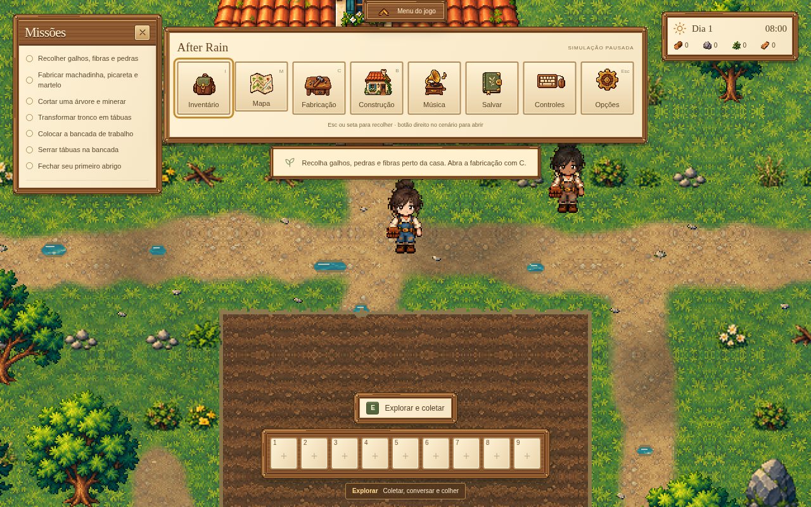
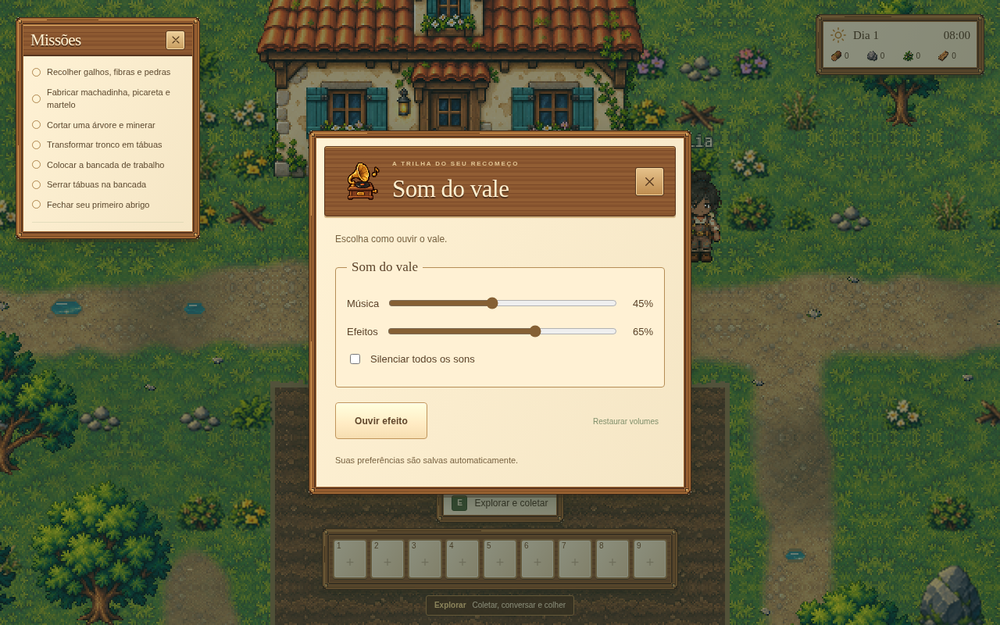
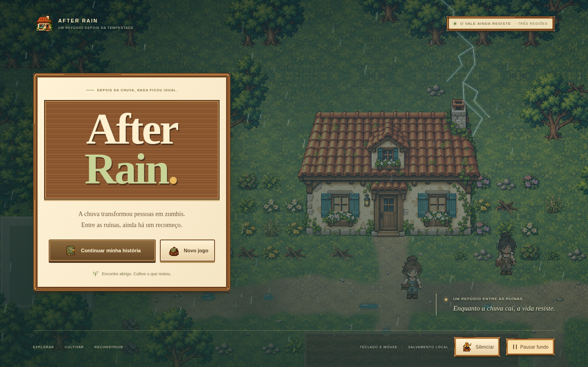

# After Rain 0.7.1 — som na barra e missões livres

O botão **Música**, com um gramofone em pixel art, abre **Som do vale** na barra superior. O painel reúne volume da trilha, volume dos efeitos, silêncio geral, prévia de efeito e restauração dos volumes. As configurações continuam salvas entre partidas e recarregamentos. A pausa já não duplica os ajustes de som.

A barra usa nove ilustrações originais combinando com a fazenda: mochila, mapa, bancada, casa, gramofone, diário de salvamento, teclado/mouse, engrenagem e seta. O atlas transparente foi desenhado para esta versão, usando a HUD aprovada como referência. Os botões mantêm seus nomes e atalhos, além dos ícones.

A aba **Missões** minimizada pode ser arrastada independentemente da janela aberta. Cada estado guarda sua posição. Um arraste não abre as missões por engano; clique ou Enter abre normalmente. Os elementos são mantidos dentro da tela ao redimensionar.

Selecionar um slot vazio, por clique ou pelas teclas **1–9**, equipa as **mãos vazias** para coletar e interagir. O slot continua vazio e não abre a mochila. Use **I** ou Inventário na barra para preencher os atalhos.

A tela inicial acompanha a HUD atual: moldura de madeira, painel creme, placa com o nome do jogo e os mesmos ícones originais. O cenário real continua visível, com a casa à direita.

A abertura ganha raios ocasionais, música calma própria e som ambiente de chuva. O botão **Ouvir a chuva** inicia o som sem sair da tela inicial. Os volumes e o silêncio geral continuam centralizados em Música.

## Validação

- TypeScript, 181 testes de sistemas e build de produção.
- Barra superior: oito ações, nove artes, abertura de todos os painéis e três tamanhos de tela.
- Áudio: duas trilhas originais, chuva estéreo e 11 efeitos sem clipping; volume, silêncio, prévia, restaurar, persistência e pausa da simulação. Transições rápidas de início/partida encerram os loops anteriores.
- Missões: mover janela e aba separadamente, alternar, recarregar, usar teclado, redimensionar e arrastar sem interagir com o cenário.
- Regressão de inventário, salvamento e tela cheia.
- Abertura: chuva, raios reais no canvas, pausa, preferência de movimento reduzido, botão de som e transições de áudio entre início/partida.
- Slots vazios por clique e teclado, troca a partir de sementes/regador/machadinha, coleta por E e persistência sem nova recompensa.

O jogo continua no projeto e na branch existentes. O save da partida, a quantidade de itens e as recompensas não mudam nesta atualização.
