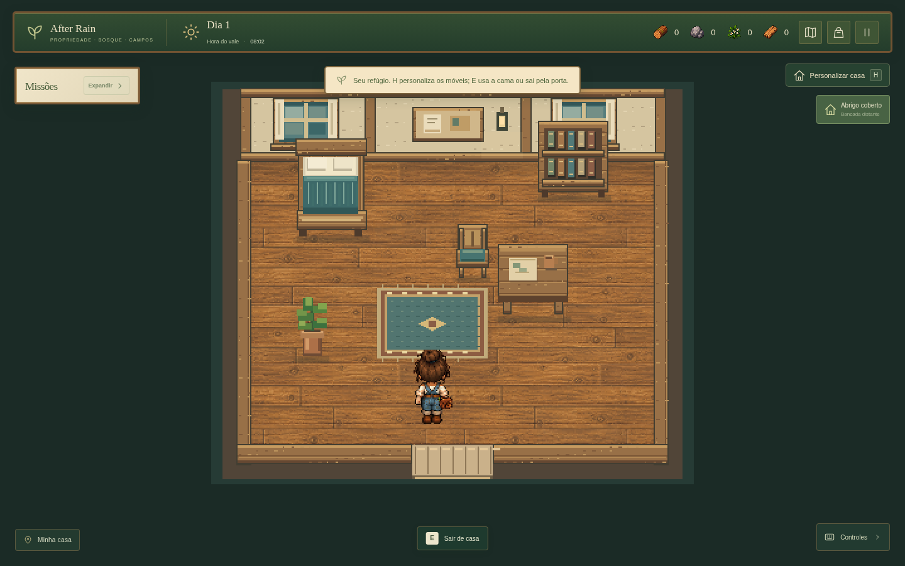
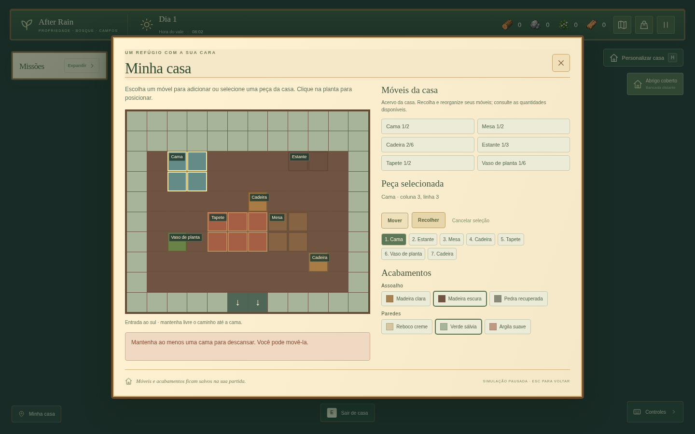

# Casa, descanso e administração — desenvolvimento 0.5.0

Esta entrega amplia o mesmo jogo Phaser. A versão Windows pública continua sendo 0.4.0; estas mudanças estão no código da próxima versão.

## O que foi implementado

- Fachada com sótão, pórtico de madeira, lanterna e reparos, preservando os pontos da porta e das janelas e a área de colisão externa. As pedras retiradas da entrada continuam ausentes.
- Entrada e saída por **E**, interior separado de 12×10 tiles, colisão nos pés e câmera fixa centralizada no cômodo. O mapa externo e sua câmera são restaurados ao sair.
- Seis tipos de móvel: cama, mesa, cadeira, estante, tapete e vaso de planta. Os sprites são originais em Canvas; o piso também reutiliza o atlas de madeira aprovado.
- Editor por **H**, **B dentro de casa**, botão do HUD ou pausa. A planta permite adicionar, selecionar, mover e recolher móveis. Três pisos e três paredes. O acervo não consome materiais nesta etapa.
- Limites: 2 camas, 2 mesas, 6 cadeiras, 3 estantes, 2 tapetes e 6 plantas. Os móveis sólidos não se sobrepõem; tapetes usam outra camada. A circulação deve permanecer conectada à saída e a última cama permanece disponível.
- Cama com confirmação de sono das 19:00 às 07:59. Acordar às 08:00 avança corretamente o calendário e o crescimento dos cultivos regados. Não implementa energia, fome ou saúde.
- Botão **X** para fechar todo o painel **Missões** e chip **Missões** para reabrir, com preferência local independente da partida.
- Painel administrativo por senha, lista dos 19 itens reais, busca e quantidade. Minimizar retoma o jogo; expandir pausa. Nenhum item é concedido sem sessão autorizada e quantidade válida.

## Persistência e autorização

O save mantém a chave histórica e a versão 2. `home` e `homePosition` são campos opcionais validados. Sem esses campos, a casa padrão é criada em memória. `player` sempre guarda a posição externa; quando salvo dentro da casa, `homePosition` guarda os pés e a direção internos. Ao sair, o campo interno é omitido. Os 19 IDs e estoques do inventário permanecem intactos.

A autorização administrativa exige senha, compara a derivação PBKDF2 e limita tentativas consecutivas. O código contém somente sal e hash. A senha foi entregue separadamente ao responsável pelo projeto. A sessão não é armazenada nem concedida por um nome de personagem; recarregar, encerrar, criar/continuar outra partida ou voltar ao início bloqueia o painel. A concessão confere autorização novamente e usa a transação atômica do inventário.

Esse controle é local: o cliente offline pode ser modificado por quem tem acesso ao código ou aos dados do aplicativo. Não representa autenticação de servidor nem contas de jogadores.

## Conferência manual

1. Execute `npm ci` e `npm run dev`. Crie um personagem ou continue uma partida existente.
2. Caminhe até a porta e use **E**. Confirme que o cômodo está inteiro na tela, que as paredes/móveis sólidos bloqueiam o movimento e que o tapete permite passagem.
3. Abra **H**. Adicione uma cadeira, mova a mesa e altere piso/parede. Tente ocupar a entrada, o personagem e outro móvel; essas ações devem ser recusadas. Tente recolher a única cama; ela deve permanecer.
4. Feche o editor. Durante a edição, relógio, cultivo e movimento devem permanecer pausados.
5. À noite, aproxime-se da cama, use **E**, cancele e confirme novamente. Cancelar não muda o horário; confirmar termina às 08:00. Cultivos regados crescem; secos continuam sem crescer.
6. Salve dentro da casa, recarregue e continue. Confirme móveis, acabamento, posição e inventário. Saia pela passagem ao sul usando **E** e confirme o retorno à propriedade.
7. Feche as missões pelo X e recarregue; o painel deve continuar fechado. Use o botão **Missões** para reabrir.
8. Abra **Esc → Administração** ou **Ctrl+Shift+F10**. Uma senha errada mantém os itens indisponíveis. A senha de administrador libera busca e concessão. Minimize, caminhe e expanda: a simulação retoma/repausa. Encerre a sessão e confirme que a senha é novamente exigida.

## Validação executada

TypeScript, **163 testes em 13 arquivos** e build de produção passaram. Os testes cobrem circulação, footprint, limites, transações e acesso, sono/calendário e compatibilidade de salvamento. No Chromium foi percorrido o fluxo de criação, caminhada até a casa, edição, cancelamento/confirmação de sono, salvamento/reabertura dentro do cômodo, saída e carregamento de um save real da versão 0.4 sem perda de inventário.

Foram conferidos os layouts 1440×900, 1280×800 e 960×640; o painel admin também foi conferido em 390×844. O build estático servido por HTTP também passou por continuar dentro da casa, dormir, editar, autenticar, listar os 19 itens, voltar ao início, continuar e recarregar. Nenhum erro JavaScript ou asset ausente apareceu no fluxo principal. A abertura interativa no Windows não foi executada neste ambiente Linux.

O interior inicial possui um cômodo. Rotação de móveis, expansão de paredes, receitas de mobília e funcionalidades de baú/cozinha/estante continuam para outra etapa. O menu de administração lista os itens já implementados; referências artísticas de itens futuros não viram itens jogáveis automaticamente.
