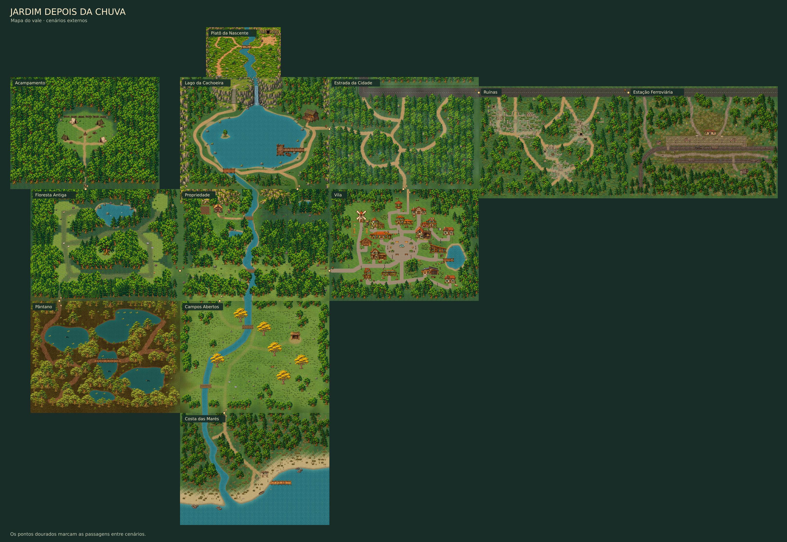

# Mapa do vale

O mapa junta todos os cenários externos. Cada um aparece na posição em que as saídas se encontram, e os pontos dourados marcam as passagens entre mapas.

A imagem reúne capturas dos cenários em 22/11/2026, com a foz da Costa e a curva da Estação atualizadas. O atlas na pasta `/workspace/afterrain-costa/` inclui também a Mina Antiga, as Galerias, dungeons e interiores em destaque.

## Posição de cada mapa

Coordenadas em pixels, com a Propriedade em (0, 0). Cada mapa tem 3072 × 2304 px (96 × 72 ladrilhos), exceto o Platô, que tem 1536 × 1024.

| Mapa | Origem (x, y) | Como se encaixa |
| --- | --- | --- |
| Propriedade Abandonada | (0, 0) | Referência. |
| Vila | (3072, 0) | Saída leste da Propriedade (94, 52) ↔ borda oeste da Vila (1, 52). |
| Floresta Antiga | (−3072, 0) | Saída oeste da Propriedade (1, 52) ↔ borda leste da Floresta (94, 52). |
| Lago da Cachoeira | (0, −2304) | Saída norte da Propriedade (75, 1) ↔ base do Lago (75, 70). O rio do Lago entra na Propriedade em x≈1373–1532. |
| Estrada da Cidade | (3072, −2304) | Borda leste do Lago (94, 33) ↔ borda oeste da Estrada (1, 33). O portão norte da Vila fica em x=50 e a base da Estrada em x=48: diferença de 2 ladrilhos. |
| Ruínas | (6144, −2112) | A estrada passa por y=10 na Estrada da Cidade e por y=4 nas Ruínas. Por isso as Ruínas ficam 6 ladrilhos abaixo. |
| Estação Ferroviária | (9216, −2112) | Mesma estrada das Ruínas, y=4. |
| Platô da Nascente | (537, −3328) | Alinhado pelo rio: a água sai da base do Platô em x≈832–1019 e cai na cachoeira do Lago em x≈1440–1485. A escadaria do Lago fica em (34, 18), dentro do mapa. |
| Acampamento dos Sobreviventes | (−3488, −2304) | Saída norte da Floresta (35, 2) ↔ base do Acampamento (48, 70). Por isso ele fica 13 ladrilhos a oeste. |
| Pântano | (−3072, 2304) | Saída sul da Floresta (18, 70) ↔ topo do Pântano (18, 2). |
| Campos Abertos | (0, 2304) | Saída sul da Propriedade x=816 ↔ chegada norte dos Campos x=816. O rio da Propriedade (x≈1329–1475) continua nos Campos. |
| Costa das Marés | (0, 4608) | Saída sul dos Campos x=912 ↔ chegada norte da Costa x=912. O rio passa em x≈460–567 e deságua no mar. |

## Ajustes feitos para as junções

- **Campos:** a chegada norte foi de x=1536 para x=816, a mesma coluna da saída sul da Propriedade. Com a chegada antiga, os Campos teriam de ficar 720 px a oeste e cobririam parte do Pântano.
  - O rio entra nos Campos com a posição e a largura do rio da Propriedade.
  - A ponte norte fica na trilha principal.
  - O trecho antigo da trilha, que só levava à borda, voltou a ter capim e árvores.
- **Pântano:** lagoas internas, com a passarela sobre a lagoa central. As bordas ficam em terra.
- **Sem ajuste:** a diferença de 2 ladrilhos entre a Vila e a Estrada da Cidade não muda nada visível. Mexer na trilha da Estrada deslocaria árvores com edições do F2.

## Pontos abertos

- A estrada da Estação continua até a borda leste, à espera de um destino. A linha principal curva para o sul junto à borda oeste e termina entre as árvores, dentro da Estação.
- O rio do Platô também chega pela borda norte. A nascente fica fora do mapa.
