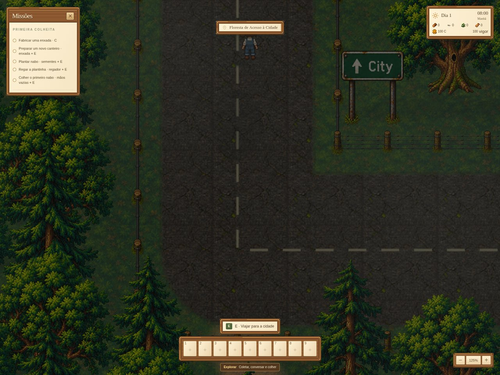

# Zoom da Floresta de Acesso à Cidade

O enquadramento padrão passa a usar a mesma escala da vila e da Floresta Antiga. Scroll, +/=/−/_, Home e botões da HUD compartilham a preferência de 50% a 200%, preservada entre os mapas. O controle aparece após uma mudança e desaparece em três segundos.

Movimentos pequenos do trackpad são acumulados antes de aplicar um passo. Scroll sem deslocamento, pausa e painéis não alteram o zoom. Ctrl/Meta/Alt com scroll ficam disponíveis para o navegador. A configuração de captura do mouse é restaurada ao sair da cena, e os listeners são removidos para não duplicar o efeito ao reentrar.

Validação: build aprovado; seis testes de preferência de câmera aprovados; verificações de navegador em `validacao.json` cobrem teclado, scroll, limites, botões, ocultação, pausa, painéis, redimensionamento e viagem vila/floresta/vila sem perder a preferência.

Alteração local, posterior ao executável da preview.14.
