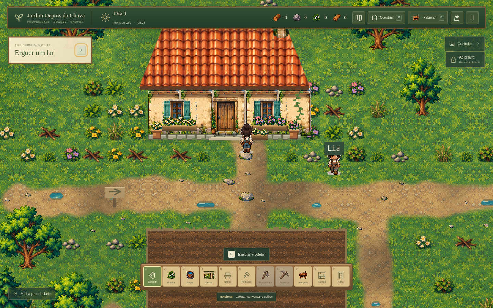

# Pedras decorativas e flores

**Estado:** aplicado ao projeto em desenvolvimento. O executável público 0.3.0 continua correspondendo à entrega anterior.

**Ajuste posterior:** a pedido do jogador, as três pedras de passagem em frente à casa foram retiradas. O acesso agora mantém o chão natural do caminho. As capturas abaixo registram a etapa anterior; a [entrada sem as pedras](capturas/entrada-sem-pedras.png) mostra o estado atualizado. A alteração afeta somente o desenho do terreno, sem modificar recursos, colisões ou partidas salvas.

As pedras de passagem ainda tinham contornos retangulares, mesmo usando uma textura mineral no miolo. Esta etapa troca a silhueta inteira por três sprites de lajes naturais, com quinas gastas, fissuras e musgo discreto. As pedras decorativas das margens também recebem uma silhueta baixa e orgânica, distinta dos seixos coletáveis e das rochas mineráveis.

Flores brancas, rosadas/lilases e amarelas passam a usar folhagem e pétalas desenhadas no mesmo estilo das árvores e recursos. Canteiros, vasos e floreiras da casa compartilham essa arte. Samambaias e capim baixo completam o conjunto.

- [Prancha dos nove sprites efetivamente usados](capturas/decoracao-galeria.png).
- [Detalhe das três pedras do caminho](capturas/decoracao-pedras.png).
- [Flores e fachada](capturas/decoracao-flores.png).
- [Decoração junto à margem](capturas/decoracao-margem.png).

## Integração

O [atlas original e sua documentação](../public/assets/visual/nature/README.md) ficam em `public/assets/visual/nature/`. `src/decor-sprites.ts` prepara os nove recortes com proporção preservada, alpha limpo e nearest-neighbor. `src/visual-assets.ts` carrega a fonte e usa as flores também na composição da fachada.

`src/terrain-art.ts` desenha os sprites completos das pedras sobre o terreno, substituindo os retângulos da camada antiga. `src/world.ts` fornece os recortes durante a criação da textura estática. `src/property-art.ts` usa os novos grupos de plantas e pedras, respeitando caminhos, água, recursos, construções e horta. Os assets anteriores permanecem disponíveis como fallback.

## Validação

- TypeScript, **123 testes em oito arquivos** e build aprovados. Permanece o aviso conhecido sobre o tamanho do bundle do Phaser.
- Chromium: nove sprites distintos, alpha apenas 0/255 e silhuetas de pedra irregulares, conferidas também visualmente no jogo.
- Comparação com o estado anterior a este lote: os mesmos **801 recursos**, as **45 parcelas** e todos os estados de colisão, construção e consultas de margem amostradas no mapa permaneceram iguais.
- Mochila pausou posição e relógio; cache do terreno foi reutilizado; Continuar e recarregar a página preservaram o mapa. Nenhum erro de JavaScript ou asset foi registrado.
- A imagem da propriedade e o detalhe das pedras foram capturados após caminhar pelo teclado desde o ponto inicial. As imagens de flores e margem usam posições carregadas de partida para enquadramento.

Esta é uma mudança de arte ornamental. As flores não introduzem uma nova coleta, e as pedras de passagem não são recursos mineráveis. Sistemas, distribuição dos recursos, colisões e formato do save continuam iguais aos da etapa anterior. Não foi gerado outro executável nem realizado teste interativo no Windows nesta etapa.

Para conferir no projeto, execute `npm run dev`.
