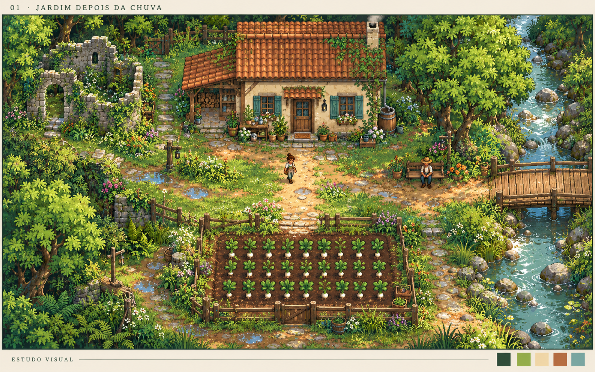
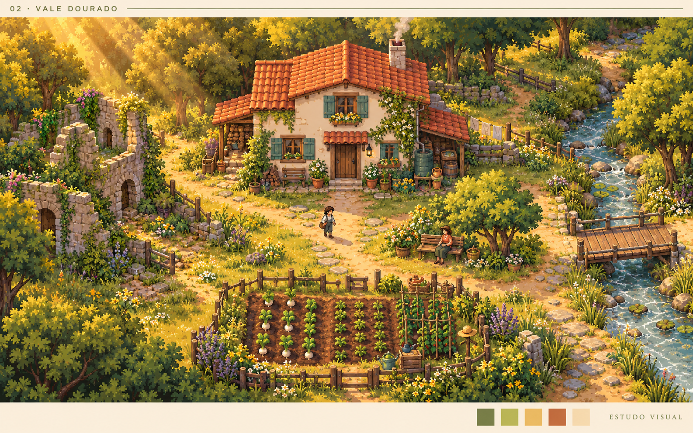
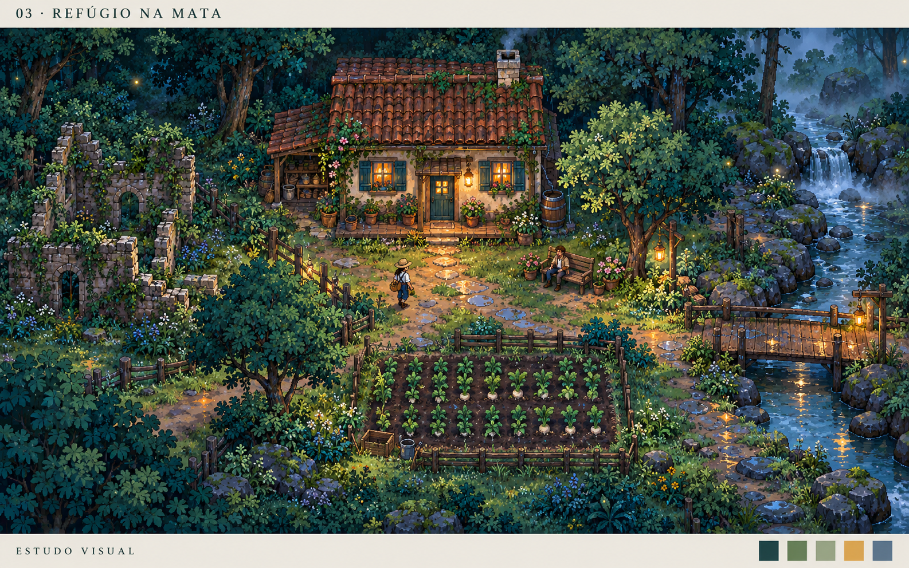

# Depois da Chuva — estudos de direção visual

Três propostas para escolher a atmosfera da próxima etapa visual. Estas imagens são **estudos conceituais para aprovação**: não são telas jogáveis e os estilos ainda não foram aplicados ao jogo.

A implementação manterá a perspectiva **2D top-down**, com arte original adaptada à leitura e às necessidades do jogo. Os estudos orientam cores, luz e ambientação; não representam uma reprodução integral das imagens.

## 1. Jardim depois da chuva

Cores naturais, vegetação acolhedora e luz suave da manhã. Uma sensação de frescor e recuperação.

## 2. Vale dourado

Uma proposta mais quente e estilizada, com tons dourados e atmosfera convidativa.

## 3. Refúgio na mata

Verdes profundos e iluminação âmbar à noite, destacando o aconchego do refúgio entre as árvores.

**Qual direção você prefere: 1, 2, 3 ou uma combinação?** Se combinar, indique quais cores, iluminação ou detalhes mais gostou em cada proposta.
