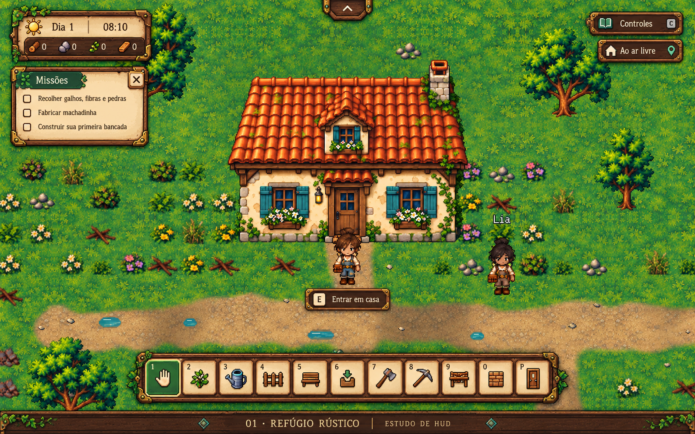
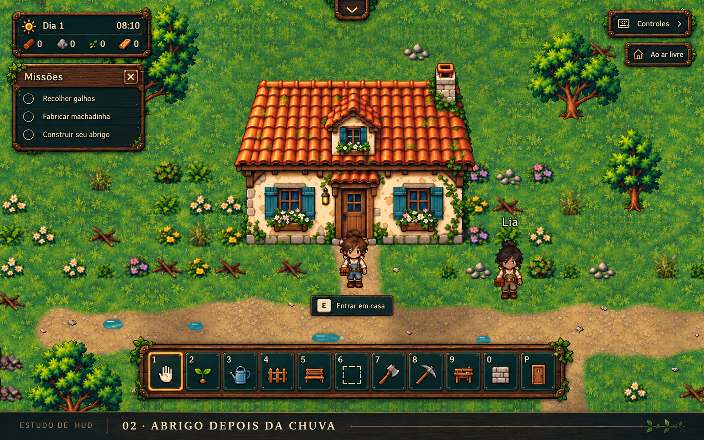
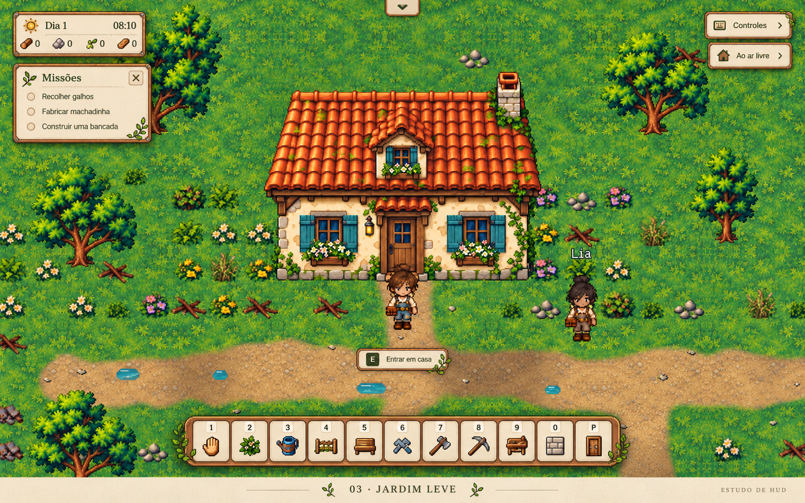

# Propostas de HUD — After Rain

Três estudos visuais gerados a partir da captura real [after-rain-entrada-hud.png](../../capturas/after-rain-entrada-hud.png), a pedido do responsável pelo jogo. São imagens conceituais para escolher materiais, cores e organização. Não são capturas de uma interface já implementada nem sprites prontos para recorte.

O jogo mantém sua HUD atual na correção 0.5.1. Os estudos ficam somente na documentação, fora dos assets distribuídos. A escolha de estilo está pendente.

## 01 — Refúgio rústico

Madeira castanha, pergaminho quente, latão envelhecido e verde musgo. A opção recomendada para acompanhar o detalhamento da casa e da vegetação.

## 02 — Abrigo depois da chuva

Madeira escura, verde petróleo, cobre e detalhes âmbar. Reforça a atmosfera de abrigo e recuperação após a chuva.

## 03 — Jardim leve

Linho creme, madeira clara, verde sálvia e ornamentação reduzida. Dá mais destaque ao cenário e uma aparência mais discreta à interface.

## Critérios para a implementação após a escolha

- Preservar o cartão compacto de dia/hora/recursos, as missões com X e a barra superior retrátil. A escala das imagens é ilustrativa: o layout real deve continuar responsivo e não bloquear o cenário.
- Usar HTML/CSS e elementos locais separados, com textos e ícones reais, foco visível, áreas clicáveis adequadas e renderização proporcional. Não usar a imagem inteira como interface.
- Manter os onze atalhos reais, os tooltips, os custos, os estados selecionados/desabilitados e o indicador contextual E/H. Os ícones e textos dos estudos precisam ser reconciliados com o catálogo real antes de implementar.
- Não adicionar barras de saúde, fome, energia ou outras mecânicas apenas por ornamentação.
- Validar legibilidade sobre grama, interior e noite; conferir teclado/mouse, quatro tamanhos de janela, modais, pausa e salvamento.
