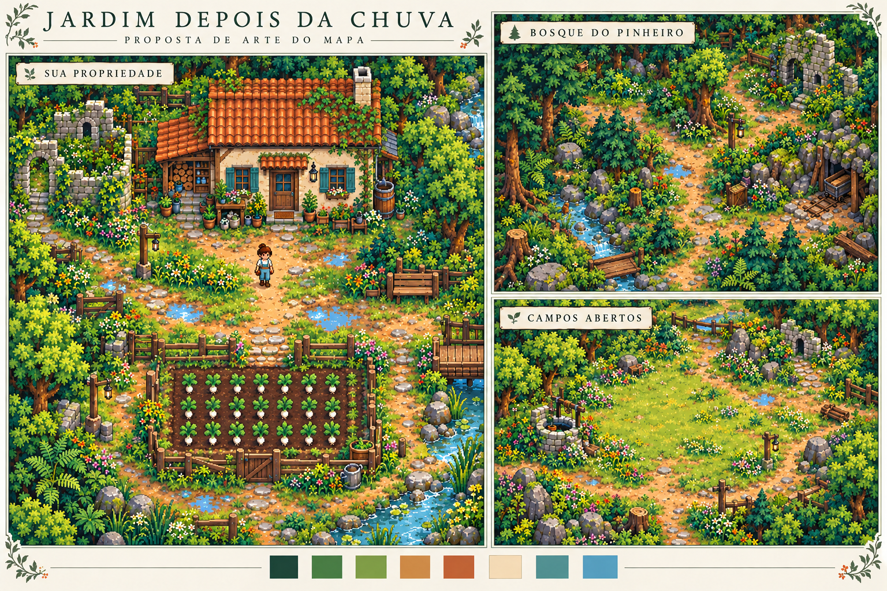

# Direção artística aprovada do mapa

**Estado: direção aprovada pelo usuário.** A primeira aplicação ao jogo está na versão 0.3.0, com foco na propriedade e nos elementos compartilhados pelas três áreas. A prancha continua sendo uma referência conceitual; o estado efetivo da implementação está em [polimento-visual-v0.3.md](../polimento-visual-v0.3.md).

A prancha gerada ilustra a aparência desejada. Elementos específicos desenhados nela, como a entrada de mina, não comprovam funcionalidades existentes nem definem automaticamente novos pontos de interesse. Na produção, ainda será necessário conferir a escala entre os três recortes e garantir variações reconhecíveis de pinheiros no bosque.

## Identidade

Pixel art 2D top-down ortográfica, com vegetação em recuperação depois da chuva, arquitetura rural e luz acolhedora. A propriedade, o Bosque do Pinheiro e os Campos Abertos compartilham escala, densidade dos pixels e direção da iluminação, com variações de cor e composição por região.

As referências principais continuam sendo [o cenário pixelado](../../referencias/otimizadas/webp/outras/cenario_pixelado.webp) e [o mapa expandido](../../referencias/otimizadas/webp/mapas/mapa_expandido.webp). A ilustração do mapa orienta a identidade do mundo; esta proposta trabalha a aparência próxima à câmera das três áreas já jogáveis.

## Melhorias definidas a partir da versão 0.2.0

1. Substituir a aparência uniforme do gramado por manchas contínuas de grama curta, sombra, terra seca e solo úmido. Os pequenos detalhes devem formar conjuntos, sem cobrir todo o chão com ruído.
2. Dar bordas irregulares aos caminhos e variar sua largura visual, mantendo as rotas transitáveis. Pedras assentadas, poças pequenas e capim nas margens reforçam o uso do lugar.
3. Criar silhuetas diferentes para árvores e pinheiros. Distribuir arbustos, samambaias e flores junto às bordas, troncos, muros e ruínas.
4. Integrar água e margens com faixas rasas, pedras parcialmente submersas, terra escura e vegetação ribeirinha. As extremidades das pontes devem se conectar visualmente ao solo.
5. Uniformizar a escala de casa, personagem, árvores, cercas, bancadas e recursos. Pedras soltas e rochas mineráveis precisam ser diferentes à primeira vista.

## Identidade por região

| Área | Cores e luz | Composição |
| --- | --- | --- |
| Propriedade | Verdes quentes, creme, terracota e venezianas azul-esverdeadas | Casa e horta como pontos principais; flores, vasos e trepadeiras nas bordas; espaço central para circular e trabalhar |
| Bosque do Pinheiro | Verdes profundos e mais frios, com aberturas de luz | Pinheiros variados, musgo, samambaias, pequenas ruínas e trilhas legíveis entre conjuntos de vegetação |
| Campos Abertos | Verdes claros, terra ocre e luz dourada suave | Gramíneas e flores em manchas esparsas; árvores nas bordas; clareiras amplas disponíveis para construção |

## Paleta inicial para experimentar

| Uso | Cor de referência |
| --- | --- |
| Sombra da floresta | `#224D3C` |
| Folhagem | `#77A64D` |
| Musgo e gramíneas | `#9CB75B` |
| Terra | `#BD985F` |
| Telhas | `#C66B3C` |
| Reboco e luz | `#EDDFBB` |
| Venezianas | `#62A5A2` |
| Água | `#508FA8` |

São cores de referência, acompanhadas de tons de luz e sombra. A seleção final depende de legibilidade e contraste na imagem e no jogo.

## Regras de produção

- Manter a grade lógica de 32 pixels e o personagem de 32×48 como referência de escala, com colisão pelos pés.
- Usar pixels nítidos, renderização nearest-neighbor e zoom inteiro. Preparar sprites e tiles com transparência, alinhamento e pivôs conferidos.
- Desenhar terreno com transições de bordas e cantos para evitar emendas ou faixas retangulares abruptas.
- Manter a mesma direção da luz. Usar sombras curtas e cores mais frias nas áreas de sombra.
- Concentrar detalhe nas bordas e marcos visuais; deixar piso de circulação e construção mais calmo.
- Preservar coordenadas de recursos, caminhos, construções salvas e horta durante a adaptação visual.
- Separar decoração e colisão. Vegetação baixa não deve parecer uma barreira; obstáculos precisam ter bases reconhecíveis.
- Preparar variações de copas e rochas para reduzir a repetição visual.
- A prancha conceitual não será importada como fundo do mapa. A implementação exige peças reutilizáveis e camadas adequadas.

## Primeira aplicação do estilo

O primeiro polimento trabalha a propriedade, com casa, caminhos, borda da horta e margem de água. Um atlas com três árvores de copa arredondada e três pinheiros fornece variações aos recursos existentes. Terreno e árvores também atendem às conexões com o bosque e os campos. A decoração mais concentrada na propriedade serve de referência para continuar o refinamento das outras áreas.

A aplicação mantém coordenadas, recursos, colisões e compatibilidade dos saves. Ainda é necessário validar o conjunto em movimento e ampliar o polimento dos demais elementos do jogo em etapas pequenas.
