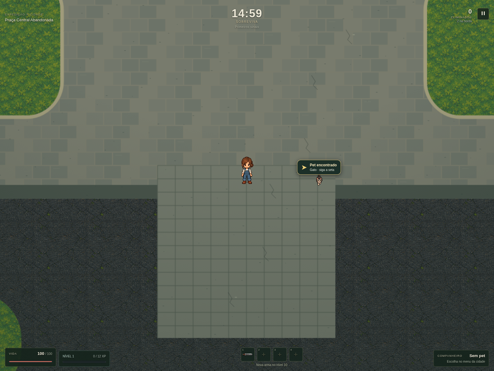
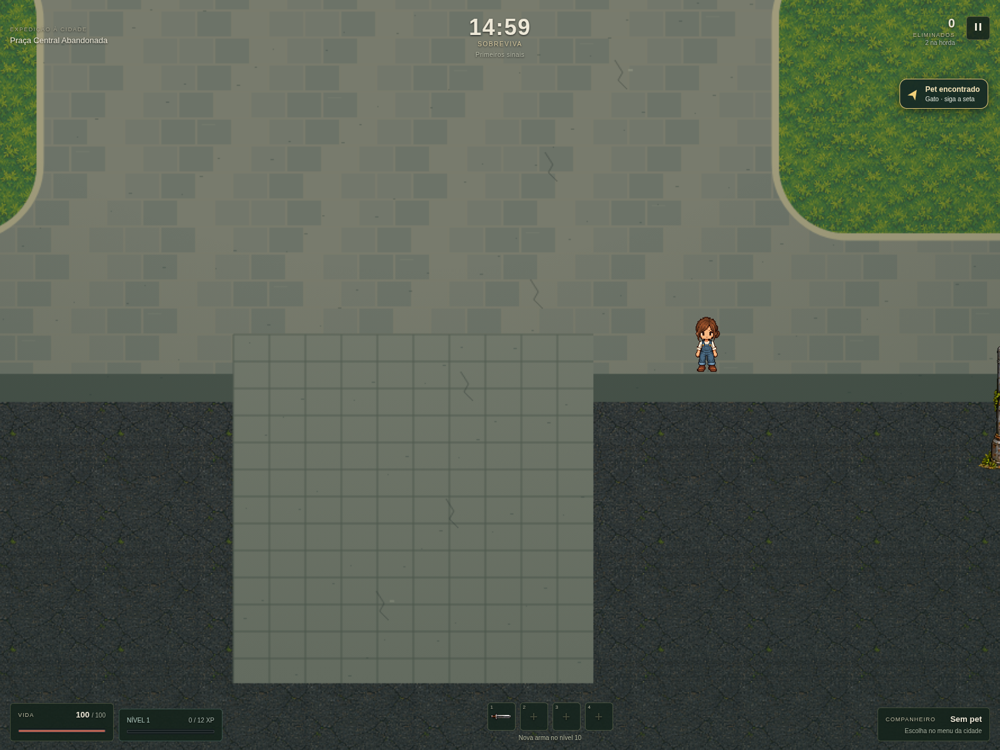
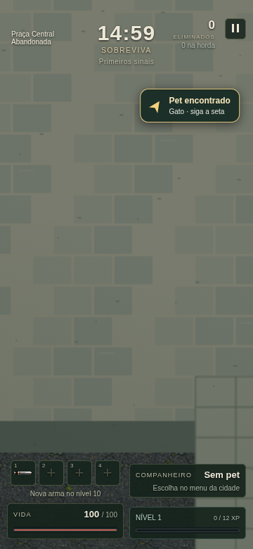

# Alerta direcional de pets — preview.14

Quando há um pet aguardando resgate, um único marcador flutuante mostra sua espécie e uma seta apontando do jogador até ele. O marcador acompanha a posição do pet na câmera; fora da câmera, permanece dentro da tela. Perto do pet, a mensagem muda para “aproxime-se”. O marcador não recebe cliques, fica oculto nos menus e desaparece assim que o pet é recolhido.

O estado vem dos pickups existentes da expedição: partidas retomadas também exibem o indicador. Não foram alterados os sorteios de aparecimento, a coleta, as recompensas ou o formato do save. Não há timers nem listeners adicionais; o elemento é reutilizado e destruído junto da interface da dungeon.

Validação: 1.139 testes aprovados em 125 arquivos; build de produção aprovado; 13 verificações de navegador aprovadas, com mudança de direção, limites da tela, pausa, retomada, restauração e resgate. Os resultados estão em `validacao.json`. O teste usa um pet inserido de forma controlada para não depender da chance de aparecimento de 2%.

No teste com Chromium/SwiftShader, forçar manualmente o resize do canvas enquanto o loop estava suspenso travou o renderizador. A validação final usa o redimensionamento normal da janela e verifica também o período em que o canvas ainda mantém o tamanho anterior. Essa execução terminou sem erros JavaScript ou requisições falhas.
