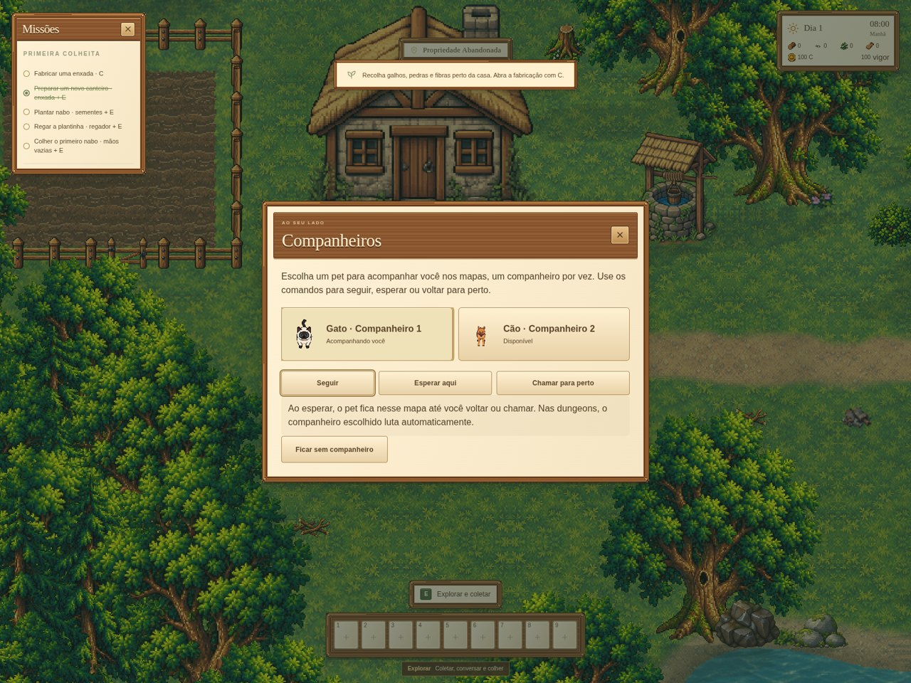
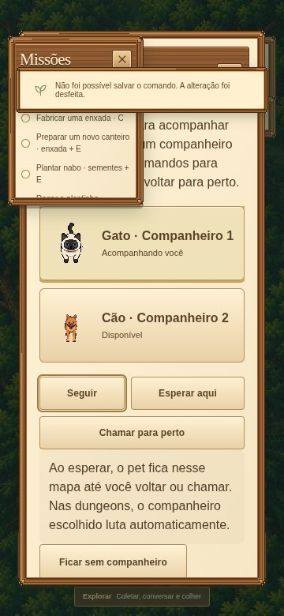
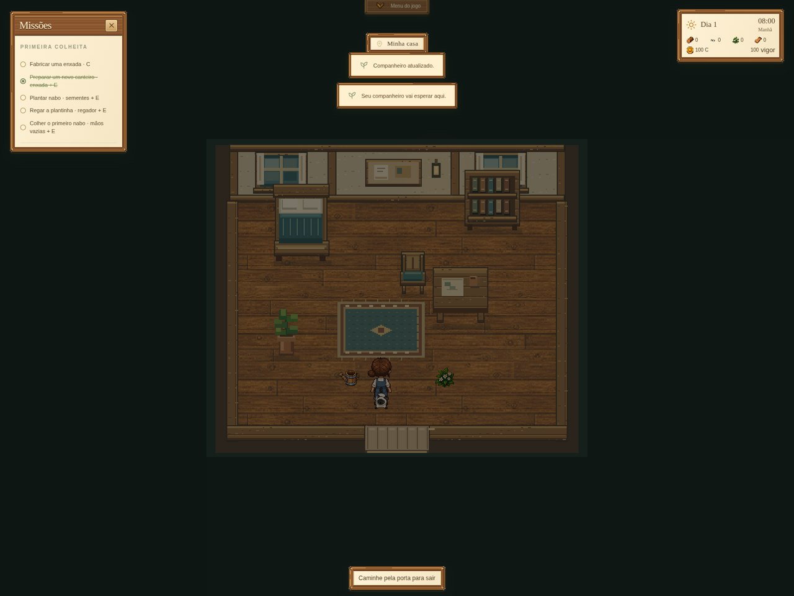
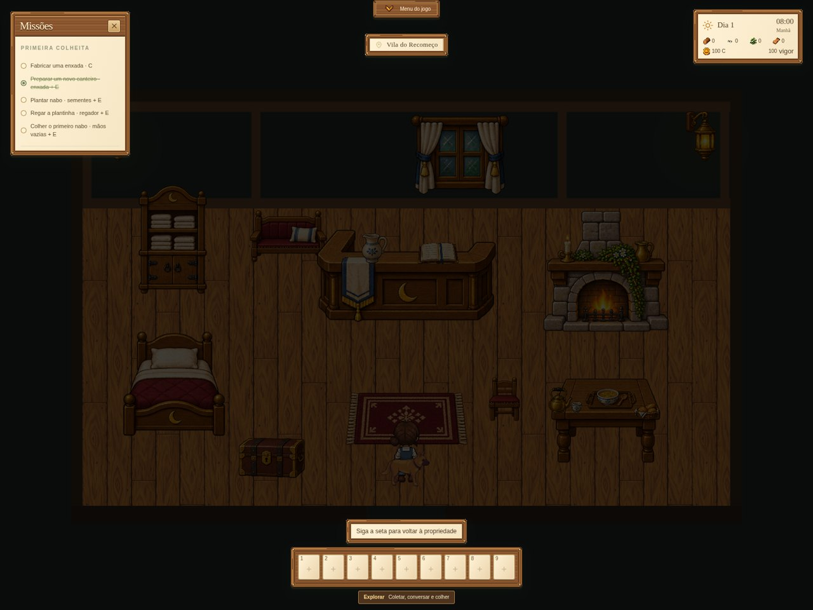
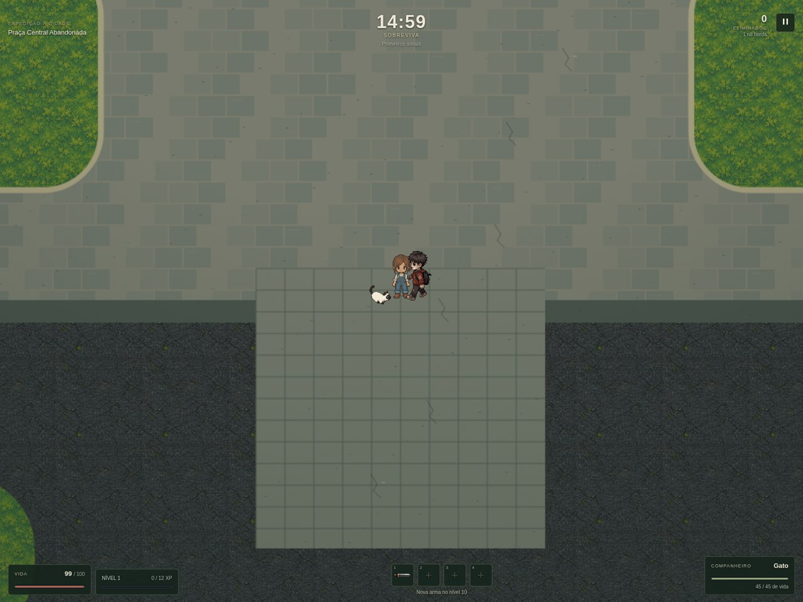
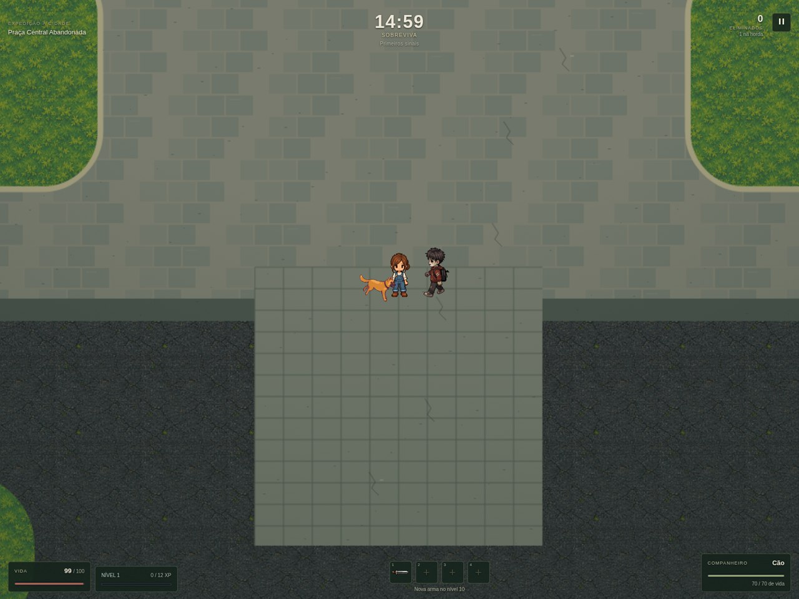
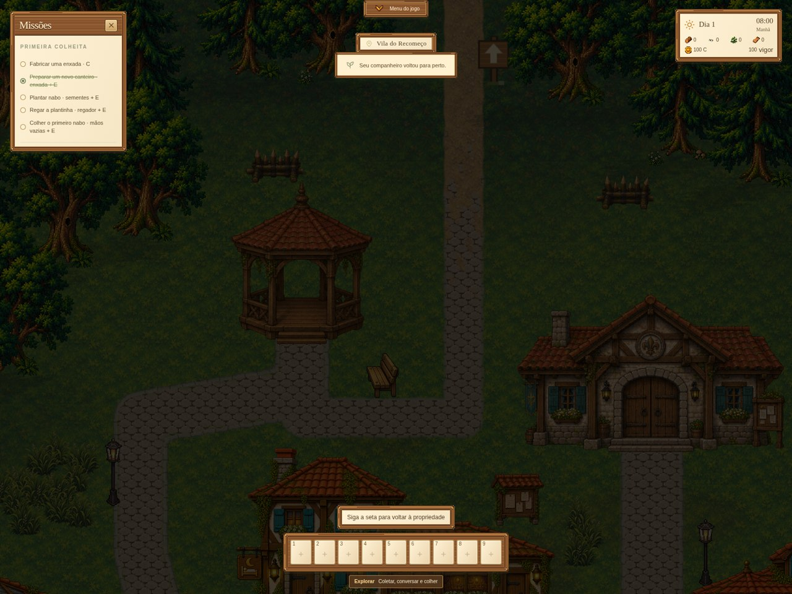

# Companheiros e caminho norte — preview.15

O gato siamês e o cachorro enviados substituem as artes dos pets ativos e dos pets para resgatar. O menu **Menu do jogo → Companheiros** permite selecionar um pet, seguir, esperar no local, chamar para perto ou ficar sem companheiro. Um pet ativo por vez; a espera mantém mapa, interior, posição e direção no save.

Os companheiros aparecem na propriedade, casa, vila, nove comércios, ferraria, Floresta Antiga e Floresta de Acesso à Cidade. A navegação usa a colisão do mapa atual, com checagem por pequenos passos e sem criar o pet sobre a água. No gato, esperar usa a sequência de sentar e repousar; retomar usa levantar. O auxílio diário de coleta da floresta de acesso permanece limitado a uma vez por dia.

## Ataques e arte

O gato usa `Jump` e o cachorro usa `Jump_Attack`. Ataques básicos e especiais têm uma ação persistida: direção, origem, destino, andamento e indicador de dano aplicado. O contato acontece no frame 6, a 0,6 segundo, e não na decolagem. Pausar congela o andamento; restaurar antes ou depois do contato não perde nem duplica o dano. Alvos atrás de obstáculos sólidos não iniciam o salto.

Os ZIPs originais e suas metadatas estão em `docs/dungeons/animacoes-pet-cat` e `animacoes-pet-dog`. Foram conferidos os hashes dos arquivos e os pixels RGBA de todos os **368 frames** (212 do gato e 156 do cachorro) contra os recortes do atlas. Nenhum frame foi redesenhado ou redimensionado. O renderer ajusta origem e escala de exibição, compensando o padding diferente entre ações. Transparência original e filtro de vizinho mais próximo são preservados; os PNGs antigos continuam guardados, sem serem carregados para os pets em jogo.

## Caminho norte

A conexão existente da vila com a estrada usa a mesma pedra das ruas junto à junção. Conforme se aproxima da saída norte, trechos de terra cobrem o pavimento e restam ilhas de pedra; as bordas também desaparecem gradualmente. O traçado, a largura disponível e as colisões foram preservados. O desenho é determinístico, gerado ao entrar no mapa, respeitando o terreno pintado pelo editor.

## Validação

- **1.158 testes em 128 arquivos**, aprovados.
- **27 verificações específicas de navegador**, aprovadas: menu, comandos, persistência, rollback em falha de gravação, todos os mapas/interiores, transparência, tela estreita, ataques básicos/especiais dos dois pets, pausa e restauração.
- **61 verificações gerais de navegador**, aprovadas: combate, chefes, escolhas, HUD, pausa, saves, recompensas, retorno ao mundo, pet na floresta e evolução permanente.
- Build de produção aprovado, com o aviso já existente sobre o tamanho do bundle.
- Cinco simulações determinísticas do modo de 15 minutos terminaram sem produzir saves inválidos. Quatro concluíram os 900 segundos e uma perdeu aos 129 segundos. O caso com cachorro concluiu os 900 segundos, chegou ao nível 661 e completou a combinação aos 510,7 segundos, sem melhorias pendentes. São testes de bot, não uma avaliação humana de equilíbrio.

Resultados em `validacao-pets.json`, `validacao-geral.json` e `simulacao-15-minutos.json`. Os testes específicos inserem pets e situações de combate controladas para não depender da raridade de aparecimento. A verificação do retorno e das recompensas está em `../retorno-recompensas/RELATORIO.md`; o zoom foi conferido em `docs/cenarios/zoom-floresta-acesso`.

Campos novos são opcionais: saves anteriores permanecem válidos. Comandos só são confirmados após salvar; falhas restauram seleção e comportamento anteriores. O controlador é único por cena e remove sua atualização ao sair, evitando pets ou eventos duplicados ao mudar de mapa.
