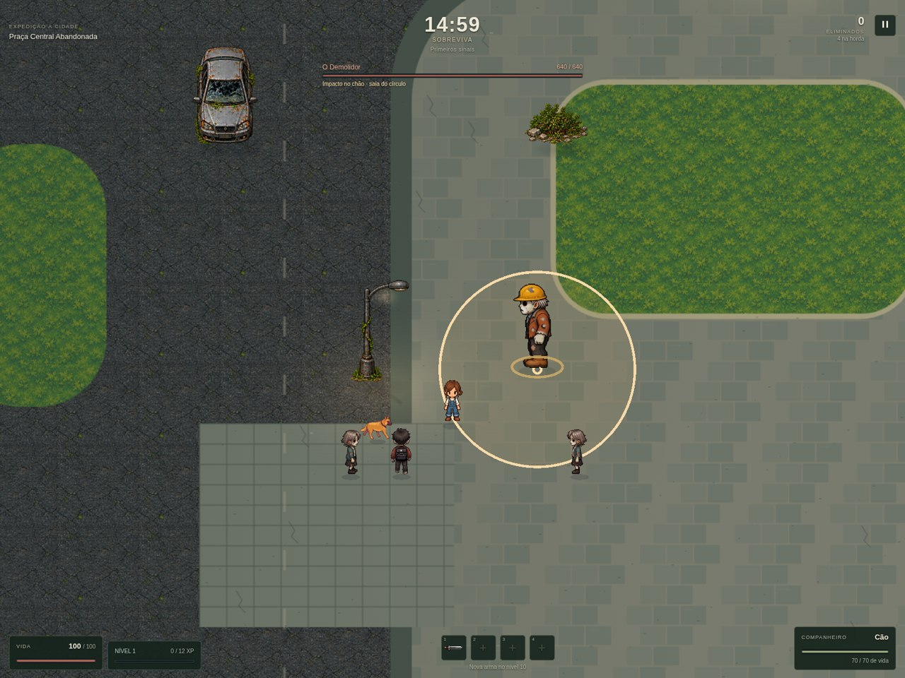
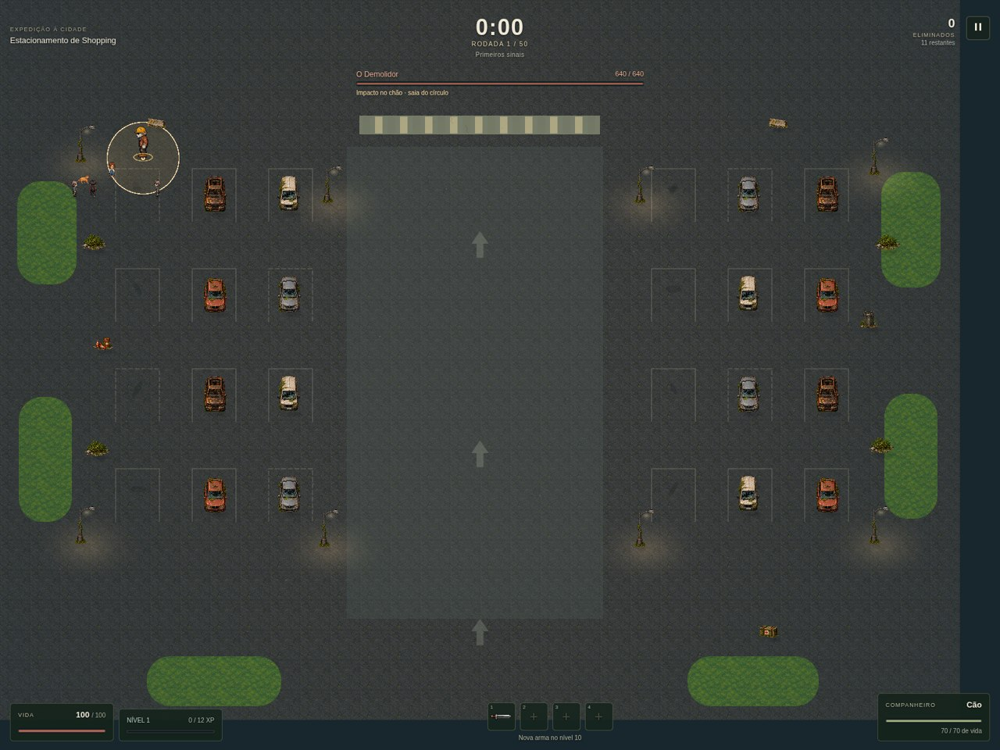

# Iluminação das dungeons

Os dois mapas receberam sombras suaves de contato sob cenário, jogador, inimigos e pet; luz quente nos postes; e uma base ambiente mais fria, com bordas menos escuras. A praça também recebe uma reflexão discreta na fonte. O fundo da câmera acompanha a paleta do cenário ao afastar o zoom.

As luzes não escurecem sprites nem a HUD. Sombras ficam abaixo dos avisos dos chefes. A oscilação dos postes é lenta e discreta, usa o relógio da simulação e congela na pausa. Intensidade e opção de iluminação dinâmica são respeitadas.

As camadas estáticas são geradas uma vez e reutilizadas. Não há normal maps, emissores ou shaders novos. O cache é limitado a duas camadas por mapa e uma textura compartilhada para os halos; objetos de luz são removidos ao sair do mapa. Terreno e colisões não mudaram.

Validação: 1.166 testes completos aprovados, build aprovado, 16 verificações específicas no navegador sem erros JavaScript, HTTP ou WebGL. Foram conferidos os dois mapas, combate com aviso de chefe, pausa, intensidade, desligamento dos efeitos e limpeza de objetos. A revisão dos companheiros também passou nas 27 verificações de mapas, comandos e ataques, considerando agora a maior distância e animações mais lentas.

Os cenários de combate das capturas são controlados. Não foi feito teste de desempenho em hardware Windows. Alterações locais após a preview.15, ainda não publicadas.
