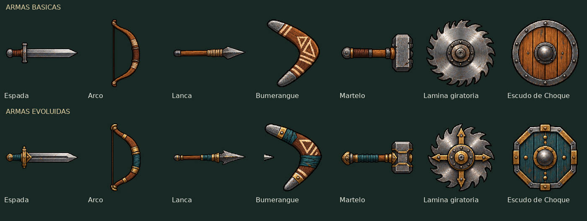
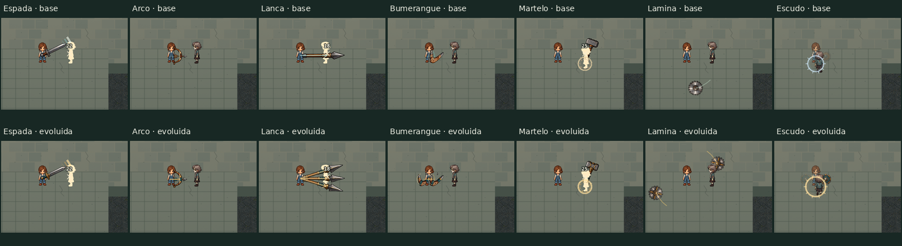
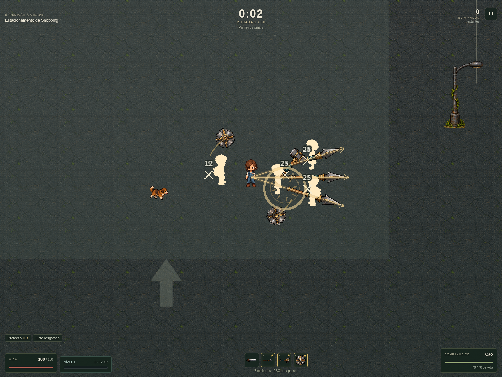

# Remake visual das armas — 29/10/2026

As sete armas das dungeons receberam novas artes básicas e evoluídas, acompanhadas de efeitos próprios e animação no combate. As cartas de evolução e os espaços da HUD usam as artes correspondentes. Dano, alcance real, cadência, duração dos efeitos, evolução, recompensas e formato do save foram preservados.



| Arma | Apresentação em combate |
| --- | --- |
| Espada | Varredura frontal, três camadas de rastro e brilho na ponta; corte alternado na evolução. |
| Arco | Recuo na soltura da corda, flechas com arte própria e rastro; flechas reforçadas na evolução. |
| Lança | Avanço e recolhimento da estocada, linha de perfuração e ponta luminosa; leque na evolução. |
| Bumerangue | Rotação, arco de movimento e rastro mais longo no retorno; duas trajetórias na evolução. |
| Martelo | Movimento de golpe, onda no chão, fissuras e poeira; segundo impacto na evolução. |
| Lâmina giratória | Disco serrilhado, rastro orbital e faíscas de contato; dois discos na evolução. |
| Escudo de Choque | Escudo de madeira/metal, indicação de cargas e onda radial de repulsão; escudo reforçado e duas cargas na evolução. |





## Arte e integração

O novo atlas `public/assets/visual/dungeons/weapons-remake.png` contém 16 sprites: sete armas básicas, sete evoluídas e duas flechas. O manifesto registra os recortes e o SHA-256. A imagem gerada foi preservada; os arquivos antigos `weapons.png` e `weapons.json` permanecem intactos.

A apresentação foi separada em `weapon-presentation.ts` (poses) e `weapon-render.ts` (desenho). Os efeitos compartilham o Graphics existente; imagens continuam reutilizadas pelos pools da cena. Não foram acrescentados emissores, timers independentes ou aleatoriedade de combate. O desenho usa o relógio e os efeitos da simulação, de modo que a pausa congela a animação.

## Validação

- Build de produção aprovado, com o aviso já existente sobre tamanho do bundle.
- Suíte completa: **1.135 testes em 124 arquivos**, todos aprovados.
- QA geral em Chromium: **61 verificações aprovadas**, sem erros JavaScript/requisições falhas; resultados em `validacao-geral.json`.
- QA individual: **17 verificações aprovadas**, incluindo as 14 combinações de arma básica/evoluída, arte exibida, ícone da HUD, ausência de tint artificial e estado congelado na pausa; resultados em `validacao-individual.json`.
- Novos testes verificam os frames das sete armas/evoluções, limites do arco da espada, alcance visual da lança e ausência de mutação do combate pelo desenho.

As capturas individuais usam estados controlados de combate para repetir a mesma composição. O QA geral também percorre combate automático, cartas, pausa, restauração, chefes e progressão. Não foi feito teste de desempenho em hardware Windows nem gerado executável nesta etapa. Alterações locais, sem publicação.

Para repetir o QA individual com o servidor Vite ativo:

```sh
QA_URL=http://127.0.0.1:5184 DUNGEON_QA_OUTPUT=/workspace/after-rain-weapon-remake-focused node scripts/qa-weapon-remake.cjs
```
