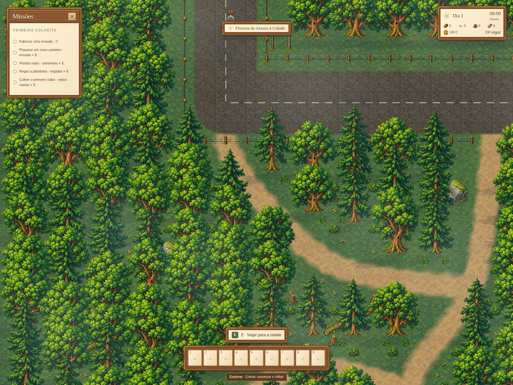

# Retorno das dungeons e recompensas — 29/10/2026

Verificação da lógica da preview.14, com uma correção local na exibição do saldo da floresta de acesso.

Vitória, derrota e abandono retornam à Floresta de Acesso à Cidade pelo botão “Voltar ao ponto de acesso”. O resultado é aplicado e salvo antes de liberar esse botão. A expedição é removida do save, e a cena normal recebe o estado com as recompensas.

| Saída | XP permanente | Moedas e materiais | Pet resgatado |
| --- | --- | --- | --- |
| Vitória | Por eliminações + bônus de vitória | Sim; peça metálica extra pela vitória | Mantido |
| Derrota | Por eliminações | Sim, proporcional ao resultado; sem peça extra de vitória | Mantido |
| Abandono | Por eliminações | Não concede | Mantido |

Os níveis, armas e cartas da expedição são temporários. A XP de evolução é registrada separadamente. Materiais sem espaço na mochila ficam pendentes; o teste automatizado de inventário cheio confirma a entrega posterior sem perda. Resultados repetidos não duplicam as recompensas.

Foi identificada uma falha visual: `CityForestScene.updateHUD` omitia `coins`, e a interface usava zero como padrão. O saldo real já estava salvo em `villageEconomy.coins`. A correção passa esse saldo para a HUD da floresta, como os demais mapas fazem. Não houve alteração de valores ou regras das recompensas.

Validação: 19 verificações de navegador aprovadas, sem erros JavaScript ou requisições falhas; 12 testes direcionados de resultado/recompensas aprovados; build de produção aprovado. As três saídas foram testadas no navegador com resultados controlados de 500 eliminações e um pet resgatado, conferindo o estado da cena normal, saldo da HUD e o save reaberto por `loadSave`. Vitória e derrota usam as condições de encerramento da simulação; abandono usa os botões da interface. O teste não representa três expedições jogadas integralmente.

Exemplo da vitória controlada: 550 XP permanente, 30 moedas, 3 sucatas, 2 tecidos, 1 peça metálica e 1 pet chegaram ao mapa normal e permaneceram no save. Resultados completos em `validacao.json`.

Correção local, ainda não incluída no executável publicado da preview.14.
