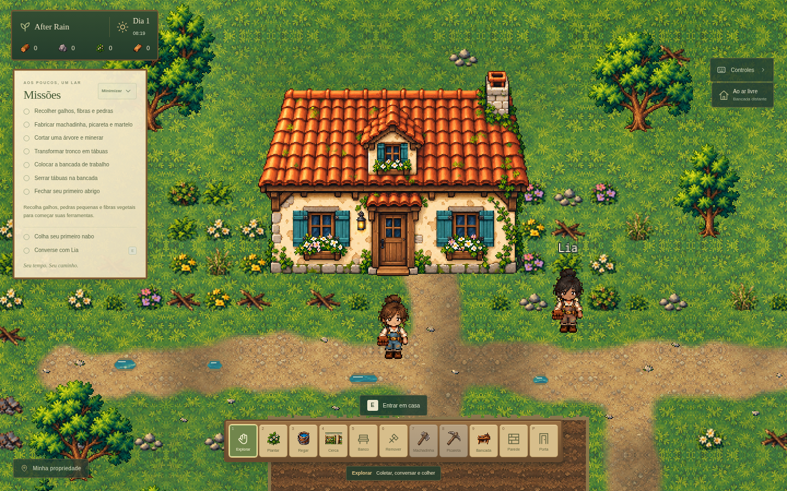
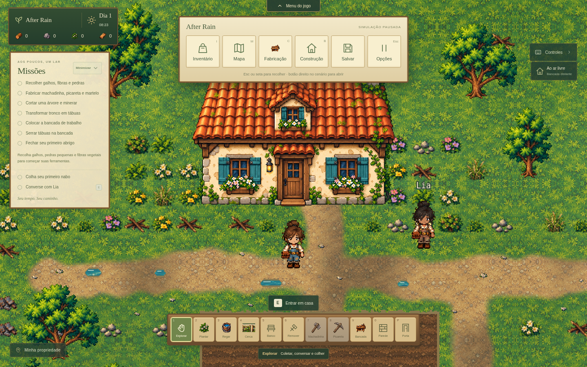

# Fachada e barra superior retrátil — desenvolvimento 0.5.0

A entrega atualiza a casa por fora e reduz a interface fixa sobre o mapa. O interior, a cama, o editor de móveis, o inventário, as receitas e os saves continuam no mesmo projeto. O executável público anterior não recebe essas mudanças automaticamente.

## Casa e cenário

A fachada foi redesenhada como uma sprite original transparente: telhas terracota, reboco creme, madeira reparada, venezianas turquesa, lanterna, floreiras e trepadeiras. O arquivo fonte está em `public/assets/visual/architecture/starter-cottage.png`. A adaptação em `src/house-sprites.ts` recorta a transparência, mantém as proporções e prepara um canvas lógico de 256×224 com filtro nearest-neighbor e borda de alpha nítida. A fonte permanece intacta.

A casa mantém o ponto de entrada e sua colisão. A nova arte não acrescenta terreno ou pedras diante da porta. As janelas têm âncoras atualizadas para a luz da abertura chuvosa. A composição anterior permanece como fallback se a textura não estiver disponível.

As cinco placas de direção/nome das regiões e a pequena seta da propriedade foram retiradas. Eram desenhos sem colisão; os caminhos e os 801 recursos do mundo não mudaram. O nome **Lia** continua visível sobre a NPC, com contorno discreto e fundo transparente. A conversa por E permanece disponível.

## Barra de opções

- Começa recolhida. Passe o mouse nos 240 pixels centrais do topo para revelar a seta. Clique na seta para abrir. O botão também pode receber foco pelo teclado.
- **Botão direito no cenário** abre/recolhe a barra, sem coletar, construir ou usar a ferramenta selecionada e sem abrir o menu de contexto do navegador no canvas.
- A barra reúne **Inventário, Mapa, Fabricação, Construção, Salvar e Opções**. Dentro da casa, oferece **Minha casa** e oculta as ações de construção externa.
- **Opções** abre a pausa existente, incluindo salvar, administração e retorno ao início.
- Apenas revelar a seta mantém o jogo ativo. Abrir a barra pausa movimento, relógio e cultivo. Trocar da barra para outro menu mantém a pausa. **Esc** recolhe a barra; depois, o atalho volta a abrir a pausa normalmente.
- Um modal aberto oculta a barra e sua área de revelação. Os atalhos I/M/C/B/H/Esc continuam funcionando. Voltar ao início destrói o dock; continuar cria uma única barra recolhida.
- Relógio e quatro contadores de recursos permanecem em um cartão compacto à esquerda. O painel de missões continua minimizável. Mensagens aparecem abaixo da barra aberta para não cobrir as opções.

## Como conferir

1. Execute `npm ci` e `npm run dev`; crie ou continue uma partida.
2. Confira a nova fachada, os caminhos sem placas e o nome da Lia sem retângulo. Aproxime-se da porta e use E para entrar e sair; confira o interior e o salvamento.
3. Leve o mouse ao centro superior. A seta aparece e o relógio continua andando. Clique: as ações aparecem e o relógio para.
4. Recolha com Esc, abra com o botão direito e acesse cada opção. Fechar cada menu deve retomar a simulação. Salvar pela barra mantém o dock aberto e a simulação pausada.
5. Use o acesso admin a partir da pausa e minimize. O jogo deve voltar a rodar. Dentro da casa, abra Minha casa e confira o editor.
6. Volte ao início e continue. A barra deve reaparecer recolhida, sem controles duplicados.

## Validação

TypeScript, 163 testes e build passaram. No Chromium foram conferidos hover/seta, botão direito, Esc, pausa, todos os botões, atalhos, acesso e minimização do admin, entrada/saída da casa, sono, salvar/recarregar dentro do cômodo e continuidade de uma partida real da versão 0.4. O fluxo principal não apresentou erros JavaScript nem assets ausentes.

As resoluções 1440×900, 1280×800 e 960×640 foram conferidas; o dock também foi inspecionado em 390×844. A execução interativa nativa no Windows continua fora da validação deste ambiente Linux.

O build estático também foi testado no navegador: barra por botão direito, inventário/opções, mensagens abaixo do dock em desktop e tela estreita, editor, sono, autenticação administrativa e salvar/continuar/recarregar. O PNG publicado no build é idêntico à fonte do projeto.
