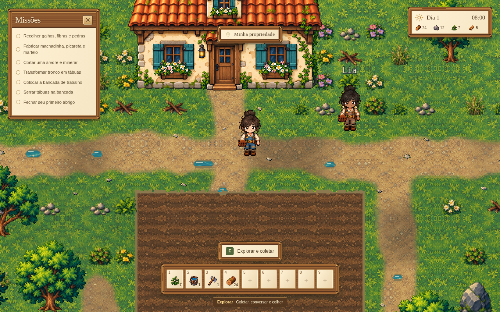
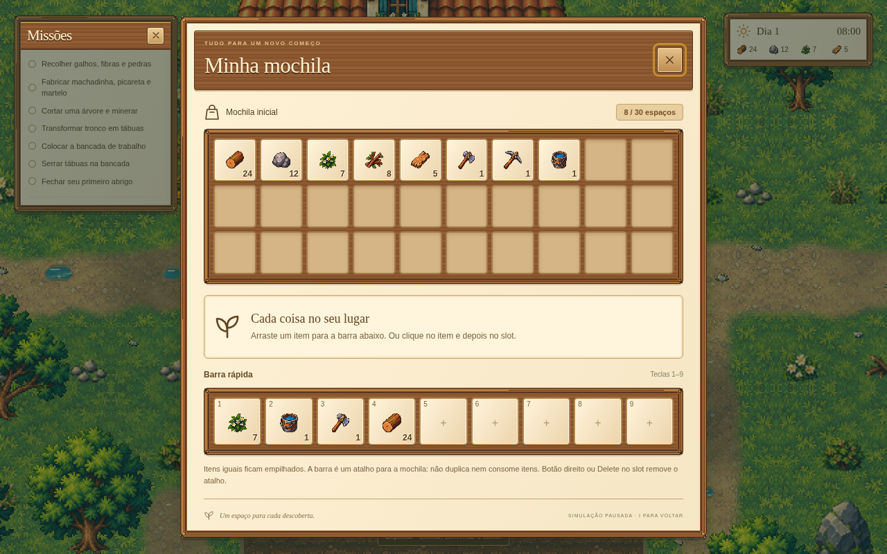

# After Rain 0.7.0

Continuação do projeto na branch `title-screen-0.5`, sobre a 0.6.1. A opção **02 — Fazenda aconchegante** orienta a HUD: madeira, papel claro, cantos dourados e relógio no alto à direita. A moldura SVG é original, aplicada em nove partes; o estudo conceitual não foi usado como textura de interface.

A mochila mantém 30 espaços para pilhas de itens e nove atalhos preenchidos pelo jogador, por arraste ou seleção por clique/teclado. Menus de mapa, fabricação, construção, casa, controles e pausa acompanham o tema. Missões têm cabeçalho arrastável, rolagem, posição salva e X.

## Som do vale

Trilha instrumental original sintetizada com Web Audio: 76 BPM, 16 compassos, aproximadamente 50,5 segundos em loop, com arpejos, baixo, melodia e acordes suaves. A cauda é incorporada ao início para evitar um corte na repetição. Sons originais para passos, botões, coleta, madeira, pedra, plantio, rega, fabricação, portas e construção. Não há gravações de terceiros, download de áudio nem dependência de serviço externo.

A primeira interação por teclado ou mouse libera o áudio. O menu de pausa oferece volume de música, volume dos efeitos e silêncio geral. Preferências ficam em `after-rain-audio-v1`, separadas do save da partida. A janela em segundo plano suspende o áudio; ao retornar, a mesma fonte musical continua, sem acumular loops. Passos exigem deslocamento real; ações sem sucesso não reproduzem a recompensa sonora.

## Tela cheia e abertura

**Ctrl + Alt** alterna a tela cheia. No navegador usa a Fullscreen API; no Electron usa a janela nativa, sem duplicar a ação no renderer. As duas ordens de pressionamento funcionam e segurar as teclas não alterna repetidamente. O atalho está na lista de controles.

Cada entrada na tela inicial começa com chuva e câmera animadas, inclusive após uma visita com fundo pausado, ao retornar da criação ou da partida. Isso segue a escolha explícita de sempre iniciar animado, inclusive com a preferência do sistema por movimento reduzido. O botão **Pausar fundo** continua disponível. A chuva não altera o save e seu canvas é removido ao entrar na partida.

## Validação

- TypeScript, 178 testes de sistemas e build de produção.
- `scripts/qa-hud.cjs`: coletas em ambas as ordens, save/reload após cada objeto, nenhuma duplicação; mapa completo com posição, interior identificado, transição exterior; slots, missões e nome temporário.
- `scripts/qa-inventory.cjs`: 30 espaços, arraste, teclado, substituição, remoção, estoque e persistência.
- `scripts/qa-audio.cjs`: renderização não silenciosa dos dez efeitos e da música, pico sem clipping, continuidade do loop, ações de plantio/rega/coleta/passos, volumes, silêncio, reload e suspensão por perda de foco.
- `scripts/qa-fullscreen.cjs`: entrar/sair, duas ordens de teclas, repetição, título, pausa e slider. Testes unitários cobrem o handler nativo do executável.
- `scripts/qa-title.cjs`: frames da chuva mudam, pausa funciona, todas as entradas reiniciam animadas e há um único canvas.
- Revisão visual de HUD, inventário, mapa, fabricação, construção, pausa, casa e noite em 1280×800, 960×640 e 390×844.

O executável Windows x64 é gerado pelo GitHub Actions em Windows. Este ambiente Linux valida o navegador e o handler nativo por testes, mas não executa uma sessão interativa no Windows 11. Saves anteriores permanecem compatíveis.
