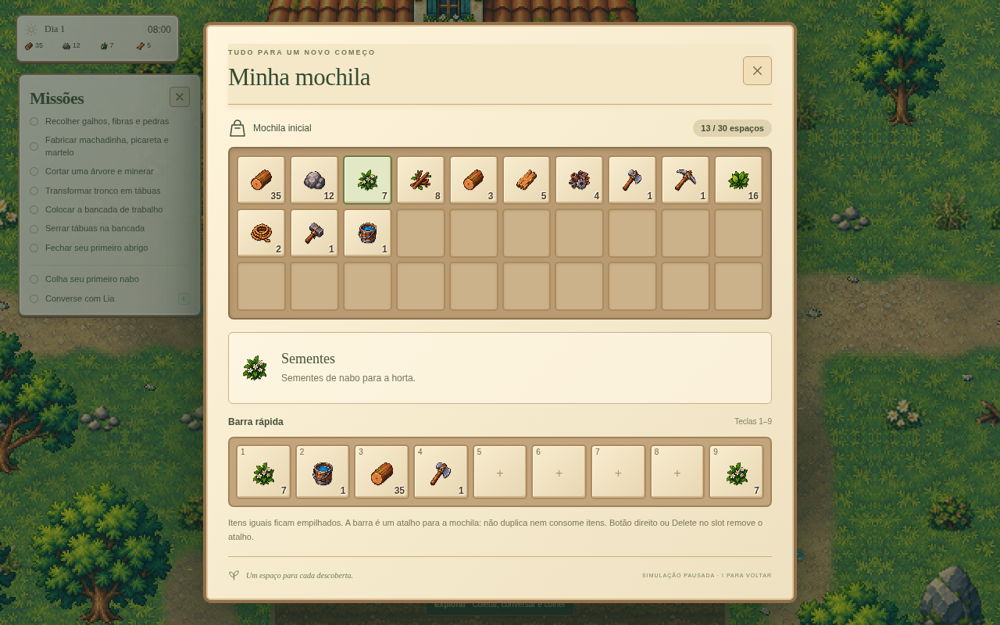

# Mochila de 30 espaços — 0.6.1

A mochila usa uma grade compacta de 10×3 no computador (6×5 em janelas estreitas), com molduras claras, fundo creme e destaques sálvia. A organização é inspirada em inventários de jogos de fazenda, mantendo os assets e a identidade de After Rain.

O limite inicial foi interpretado como **30 espaços para pilhas**, não 30 unidades somadas. Itens iguais compartilham um espaço; o limite numérico de cada tipo continua o existente. O catálogo atual tem 19 tipos de estoque e o regador recolhível. Somente itens possuídos aparecem na grade; espaços vazios continuam visíveis. Coleta, crafting e construção mantêm as transações atômicas existentes.

## Uso

- I abre e fecha a mochila; a simulação fica pausada.
- Arraste um item da grade para um dos nove slots da barra rápida exibida no painel. A barra do jogo recebe o mesmo atalho.
- Alternativa por clique/teclado: selecione um item e acione o slot de destino. Tab e Enter permitem navegar sem arrastar.
- Botão direito ou Delete sobre um slot no inventário remove o atalho. Soltar outro item substitui o anterior.
- 1–9 ativa os atalhos durante o jogo. Sementes plantam, regador rega, machadinha corta e picareta minera. Os demais itens continuam sendo materiais usados por crafting/construção e mostram sua função ao selecionar.
- A barra referencia o estoque: não move, consome ou duplica a pilha. As quantidades refletem a mochila; um atalho cujo item acabou fica com zero e não ativa uma ação.
- Clique em um slot vazio durante o jogo abre a mochila. A configuração antiga de ações segue disponível por botão direito, preservando atalhos de construção existentes.

## Saves e testes

Os nove slots aceitam referências estáveis `item:<id>` além dos atalhos antigos. Saves da 0.6.0 continuam carregando. O regador permanece registrado como coleta única e agora também aparece na mochila. Nenhuma migração apaga ou converte quantidades.

Validação: TypeScript, 172 testes de sistemas, build e Chromium. A automação `scripts/qa-inventory.cjs` verifica 30 espaços, pilhas, arrastar itens, alternativa por clique, atalhos 1–9, substituição, remoção, esgotamento, salvamento/recarga sem duplicação e três tamanhos de janela. `scripts/qa-hud.cjs` foi atualizado para o novo fluxo da mochila e cobre as coletas, mapas e missões anteriores.

