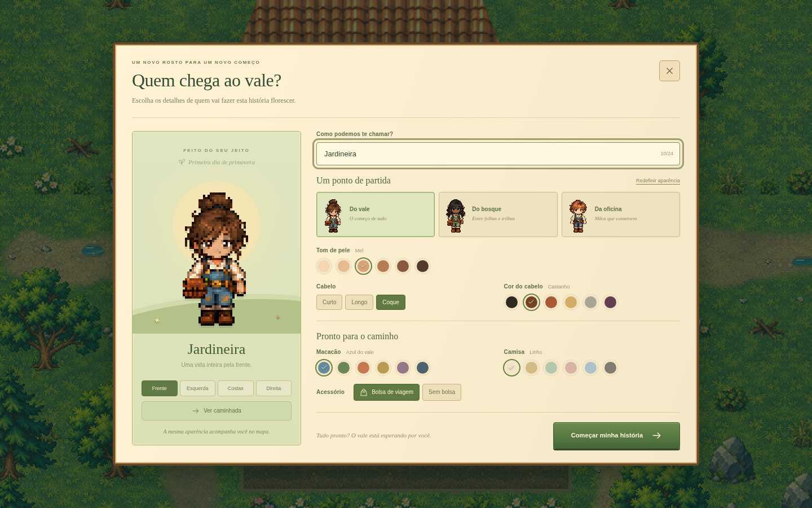
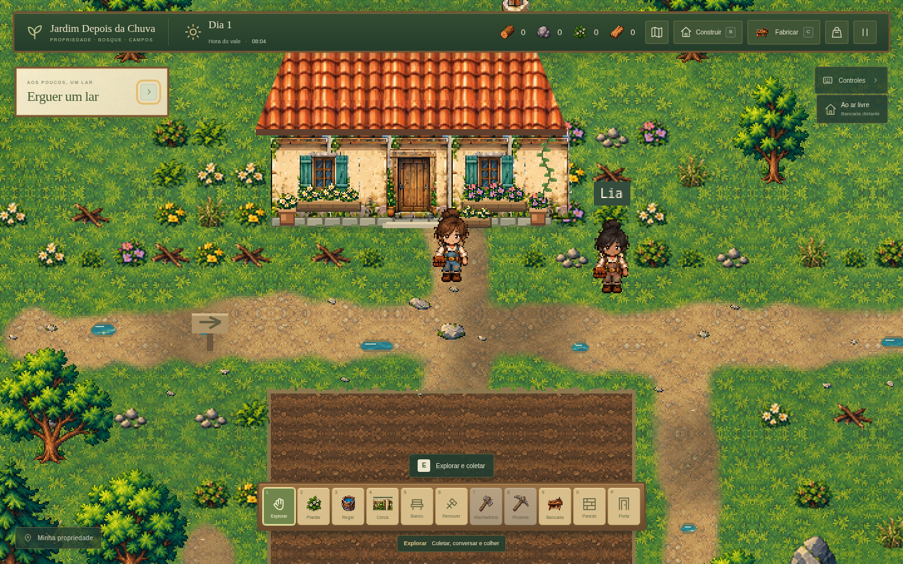

# Personagem e criação de aparência

Esta etapa continua o jogo existente e a direção visual aprovada. O personagem ganha novos sprites locais, com cabelo, camisa de mangas dobradas, macacão, botas e bolsa de couro. O visual inicial segue a ficha original; curto e longo têm folhas próprias, sem blocos retangulares acrescentados ao coque.

## O que está implementado

- Três folhas com 16 poses cada: quatro direções e quatro quadros de caminhada. As vistas laterais são desenhadas em perfil, com a proporção preservada.
- Canvas lógico de 48×64, antes 32×48. A arte visível chega a 60 pixels de altura. A câmera e os tiles de 32 pixels mantêm suas escalas.
- Mesma origem dos pés `(0.5, 1)`, posição no mundo, colisão de 14 pixels de largura, velocidade e ordenação por profundidade. A ampliação é visual.
- Editor com nome, três penteados, seis tons de pele, seis cores de cabelo, seis cores de macacão, seis cores de camisa e bolsa opcional.
- Três aparências prontas: Do vale, Do bosque e Da oficina. Redefinir aparência mantém o nome digitado.
- Prévia ampliada quatro vezes, com botões para frente, esquerda, costas e direita, e caminhada opcional. A prévia e a partida usam a mesma função de desenho.
- Seleções com indicação visual, nome de cor, rótulo acessível e `aria-pressed`. O editor tem rolagem vertical em janelas menores.
- Camisa e acessório persistem no save. Perfis antigos recebem defaults somente na renderização, sem regravar o slot ao ler. A chave e a versão 2 permanecem.
- A criação continua pausando a simulação. A animação da prévia encerra ao parar, voltar ou iniciar. Digitar o nome não movimenta o personagem.
- O retrato de diálogo usa a proporção do novo canvas, e a placa de Lia fica acima da cabeça, com afastamento derivado da altura da sprite.

## Arquivos

- `src/character-sprites.ts`: preparação dos atlases, materiais, bolsa e cache.
- `src/art.ts`: API compartilhada de desenho e atlas de animação do jogador; arte anterior como fallback.
- `src/visual-assets.ts`: carregamento local e preparação das novas fontes.
- `src/scenes/ValleyScene.ts`: placa de Lia ajustada à nova altura.
- `src/character-creator.ts`, `src/ui.ts`, `src/style.css`: editor e integração com os menus.
- `src/types.ts`, `src/data/character-options.ts`, `src/systems/save.ts`: perfil, defaults e validação compatível.
- `tests/character-profile.test.ts`: persistência e recusa de campos inválidos, incluindo leitura de saves anteriores.

Fontes, dimensões, ordem dos quadros e hashes estão em [assets de personagem](../public/assets/visual/characters/README.md).

## Capturas reais

- [Doze vistas e três aparências](capturas/personagem-galeria.png).
- [Prévia lateral](capturas/personagem-lateral.png).
- [Personalização de cores e penteado](capturas/personagem-personalizacao.png).
- [Editor em 960×640, com rolagem](capturas/personagem-criacao-960.png).
- [Retrato de diálogo proporcional](capturas/personagem-dialogo.png).

## Validação executada

- `npm run check`: aprovado.
- `npm test`: **135 testes em 9 arquivos**, todos aprovados, incluindo 12 novos casos de personalização e compatibilidade de save.
- `npm run build`: aprovado, com o aviso já conhecido sobre o tamanho do bundle Phaser.
- Chromium via Playwright: 48 quadros preparados; quatro vistas distintas por penteado; caminhada; alpha binário; remoção dos resíduos abaixo das botas; todas as 24 cores refletidas na prévia; bolsa, presets e redefinição.
- Fluxo real de criação, digitação com WASD, movimento, pausa pela mochila, salvar, continuar e recarregar. Aparência da prévia conferida contra o atlas em jogo; leitura de save v2 sem os novos campos também aprovada. Sem erros JavaScript ou falhas HTTP de assets.
- Editor conferido em 1280×800 e 960×640: canvas ampliado exatamente 4× e sem rolagem horizontal. A janela menor usa rolagem vertical.
- Regressão do mapa: mesmos 801 recursos, IDs, posições, colisões, margens, construibilidade e 45 parcelas de cultivo da etapa anterior; cache do terreno e save/reload preservados.
- Conferência final da placa de Lia: intervalo de 6 pixels entre a caixa da sprite e o nome. Retrato com fonte 48×64 exibida em 96×128, sem distorção.

As capturas da propriedade usam o personagem padrão e caminhada pelo teclado até a frente da casa. A captura de diálogo usa uma posição de save preparada próxima de Lia. Não foi executado um teste nativo do aplicativo Windows nesta etapa.

## Como conferir

1. Execute `npm ci` e `npm run dev`, abra o endereço informado pelo Vite e escolha **Novo jogo**.
2. Digite um nome com letras WASD; o mundo deve permanecer parado. Alterne penteados, cores, bolsa e presets.
3. Confira as quatro vistas, ligue e pare a caminhada. Redefina a aparência e verifique que o nome permanece.
4. Inicie a partida: a aparência deve corresponder à prévia. Caminhe nas quatro direções, junto da casa e das margens.
5. Abra a mochila ou pause: movimento e relógio devem parar. Salve, recarregue e continue a mesma partida.
6. Para conferir compatibilidade, use uma cópia de um save anterior: pele, cabelo e macacão devem ser preservados; camisa e bolsa usam defaults.

## Limites desta etapa

A personalização acontece antes de começar uma partida. Ainda não há guarda-roupa durante a história, seleção de corpos, barbas, chapéus ou editor de roupas por peças. As ações de ferramenta continuam usando os efeitos existentes; as novas folhas cobrem ficar parado e caminhar. A recoloração mantém os detalhes e sombras das fontes, sem prometer uma paleta indexada desenhada manualmente por material.

Esta integração está no checkout de desenvolvimento. O executável público 0.3.0 permanece na entrega anterior; esta etapa não publica um novo pacote Windows.
