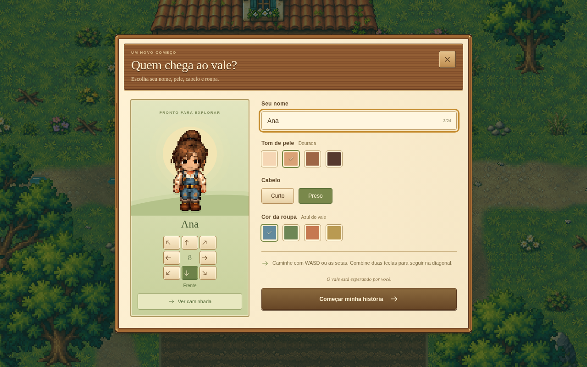
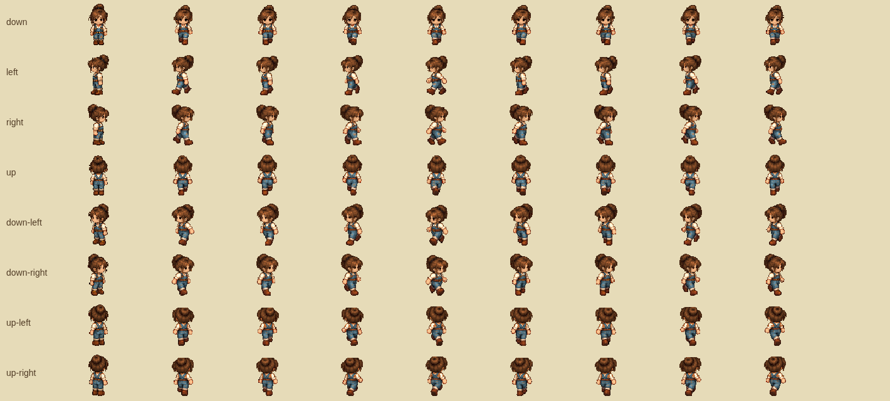
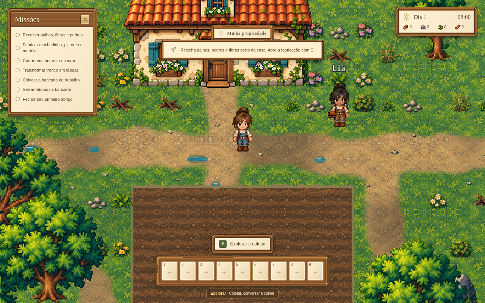

# After Rain 0.8.0 — personagem, caminhada e árvores

O personagem acompanha a arte detalhada do vale: cabelo castanho, camisa clara de mangas dobradas, jardineira e botas. O editor oferece poucas escolhas: nome, quatro tons de pele, cabelo **Curto** ou **Preso** e quatro cores de roupa. A prévia permite conferir as oito direções e iniciar ou parar a caminhada antes de entrar na partida.

## Movimento e animação

Há oito direções: frente, costas, esquerda, direita e as quatro diagonais. Cada direção usa uma pose parada e **oito quadros de caminhada a 10 fps**, totalizando 72 posições no atlas de cada aparência. A prévia e o personagem no cenário usam o mesmo renderizador e a mesma cadência.

WASD e as setas continuam movimentando o personagem. Duas teclas combinadas produzem uma diagonal com a mesma velocidade total das direções retas. Parar ou encontrar um obstáculo restaura a pose parada. As colisões continuam verificando a área dos pés em pequenos passos; a arte ampliada das árvores não ocupa novas células.

A direção diagonal também orienta a interação por **E**, mantendo o alcance existente. Ela é salva e restaurada tanto no exterior quanto dentro da casa.

## Arte e compatibilidade

O desenho final cabe em 48×64 pixels, com o pivô nos pés e amostragem sem suavização. As folhas são preparadas no Canvas para recorte, alinhamento, orientação e aplicação das cores escolhidas. As imagens originais permanecem preservadas.

Cinco folhas originais foram geradas com a ferramenta de imagens para esta versão, seguindo a arte do personagem já presente no projeto:

| Arquivo em `public/assets/visual/characters/` | Uso |
| --- | --- |
| `farmer-bun-idle-eight.png` | Poses paradas do cabelo preso |
| `farmer-short-idle-eight.png` | Poses paradas do cabelo curto |
| `farmer-bun-walk-eight.png` | Oito quadros de caminhada nas oito direções, cabelo preso |
| `farmer-short-walk-eight.png` | Oito quadros de caminhada nas oito direções, cabelo curto |
| `farmer-long-walk-eight.png` | Cabelo longo para compatibilidade com personagens já salvos |

A origem e os hashes SHA-256 estão em [origem-dos-assets.json](origem-dos-assets.json). As folhas anteriores e os pacotes recebidos continuam no repositório.

O editor simples não altera os perfis já salvos. Cabelo longo, cor de cabelo, cor de camisa e bolsa continuam sendo lidos quando presentes. A chave `depois-da-chuva-v1` e o formato de save versão 2 permanecem; saves anteriores sem direção continuam válidos. Estoque, recompensas da casa, recursos removidos e construções são preservados.

## Árvores

As árvores adultas em pé usam escala **1,6**, ficando 60% maiores. A posição do tronco, a ordenação de profundidade, os IDs dos recursos e as colisões permanecem iguais. A área consultada para tornar a copa translúcida acompanha o novo tamanho: o personagem continua visível ao passar atrás das árvores. Arbustos, madeira caída e tocos mantêm suas escalas anteriores.

## Capturas do jogo

## Validação

- TypeScript e build de produção aprovados.
- QA do build no Chromium: criação, mãos vazias, mochila de 30 espaços, som e salvar/recarregar/continuar sem erros.
- **203 testes de sistemas aprovados**, incluindo movimento nas oito direções, velocidade diagonal, colisão em cantos, bloqueio junto à parede, ciclo completo de oito quadros e persistência das direções.
- `scripts/qa-character.cjs` aprovado no Chromium: oito quadros de caminhada visualmente distintos em cada direção e nos dois cabelos da criação, poses paradas e escolhas de aparência.
- Editor conferido em 1280×800, 960×640 e 390×844, com o botão de começar alcançável. O jogo publicado continua destinado a computador com teclado e mouse.
- Movimento pelo teclado nas oito direções, interação diagonal por E e salvar/recarregar no exterior e no interior da casa.
- Árvores maiores, transparência atrás das copas e retorno à opacidade ao sair, sem erros de JavaScript ou carregamento de assets no fluxo.

O QA de navegador usa Playwright e Chromium disponíveis no ambiente de desenvolvimento. Os testes de sistemas podem ser reproduzidos com `npm test`; TypeScript e build usam `npm run check` e `npm run build`.

## Distribuição

- [Jogar no navegador do computador](https://after-rain-junior-desktop.astralpeach256.chatgpt.site), com acesso pela conta do ChatGPT.
- [After Rain 0.8.0 para Windows x64](https://github.com/juniorangel2000-commits/Junior/releases/download/v0.8.0/After-Rain-0.8.0-Windows-x64.exe).
- [Release e manifesto SHA-256](https://github.com/juniorangel2000-commits/Junior/releases/tag/v0.8.0).

O workflow Windows verifica TypeScript, testes e build antes de gerar o portátil e publicar o executável com `SHA256SUMS.txt`. O save do navegador é separado do save do executável. A abertura interativa no Windows 11 não foi testada neste ambiente Linux.
