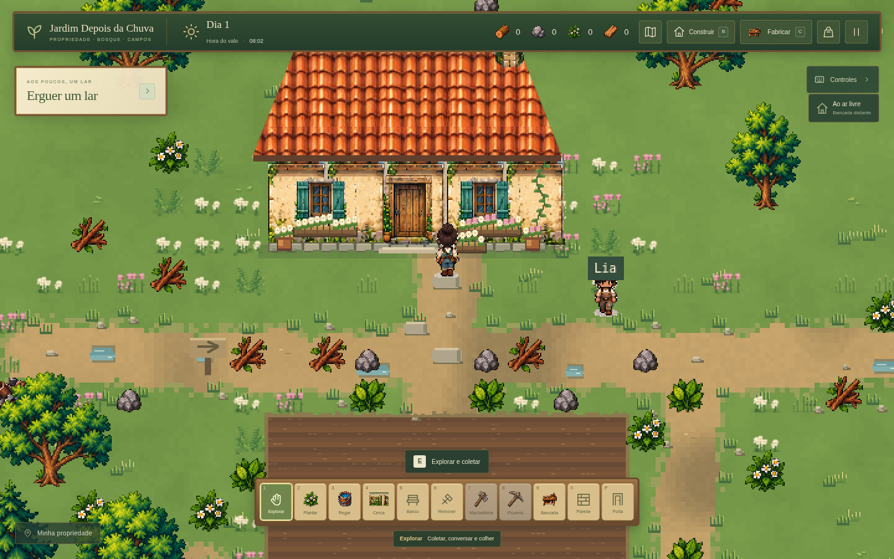

# Primeiro polimento visual — versão 0.3.0

Esta etapa aplica a [direção artística aprovada pelo usuário](direcao-visual/proposta-arte-mapa.md) ao projeto existente. O foco é a propriedade, com elementos de terreno e vegetação compartilhados com o Bosque do Pinheiro e os Campos Abertos.



## O que mudou

- **Terreno:** grama em manchas contínuas, paletas graduais entre as áreas, caminhos visualmente mais estreitos e irregulares, pequenas poças, pedrinhas e solo da horta.
- **Água e pontes:** água rasa e profunda com cores distintas, detalhes nas margens e desenho das duas travessias, mantendo seus limites físicos.
- **Árvores:** três variações de copa arredondada e três pinheiros, escolhidos pelas coordenadas para reduzir a repetição sem mudar os recursos.
- **Propriedade:** grupos de flores, samambaias, gramíneas e pedras baixas perto da casa, horta, ruínas e água. Os caminhos e os 45 tiles cultiváveis são protegidos da decoração.
- **Casa:** floreiras nas janelas, vasos de terracota e base de pedra. O arquivo original `planta.png` continha um recorte de tapete; esse uso foi removido da fachada e substituído por plantas desenhadas em Canvas.
- **Recursos:** pedras soltas usam canvas de 26×22 pixels; rochas mineráveis usam 44×48, tornando os dois tipos mais fáceis de distinguir.
- **Visibilidade:** árvores que encobrem o personagem ficam transparentes enquanto ele passa atrás da copa. O tronco continua com a mesma colisão.

## Arte e organização

O arquivo [trees-approved.png](../public/assets/visual/nature/trees-approved.png) é um atlas original de 1536×1024 pixels, criado a partir da direção aprovada. Ele tem três colunas e duas linhas. A imagem-fonte permanece preservada; `src/nature-sprites.ts` adapta os quadros em Canvas, remove halos de transparência e alinha a base do tronco em um pivô comum. As texturas resultantes têm canvas de 104×132 pixels, com escala compartilhada para manter as diferenças entre árvores jovens e maduras.

`src/terrain-art.ts` pinta o terreno estático. `src/property-art.ts` compõe os detalhes baixos em uma única textura de 1632×1248 pixels, na profundidade -40, sob atores, pisos e estruturas. `src/visual-assets.ts` mantém o carregamento e a adaptação dos assets locais. A renderização usa nearest-neighbor e a visão permanece top-down ortográfica.

Os pacotes e referências recebidos continuam intactos. A prancha conceitual não é usada como fundo de mapa. Elementos desenhados nela, como a entrada de mina, continuam sendo referências e não comprovam novos sistemas ou locais jogáveis.

## Compatibilidade e desempenho

- O mundo permanece com **96×72 tiles de 32 pixels** e as mesmas três áreas.
- A seleção visual das árvores não altera IDs, posições, golpes, recompensas ou esgotamento de recursos.
- Construções, horta, caminhos transitáveis, água e colisões mantêm a geometria anterior.
- O formato do save continua na versão 2, com a chave `depois-da-chuva-v1` e o diretório desktop `%APPDATA%\Depois da Chuva`.
- O terreno independe do save; sua textura é reutilizada entre Novo Jogo e Continuar. Os detalhes da propriedade são refeitos para respeitar recursos e construções da partida carregada.
- A oclusão consulta árvores próximas ao personagem, sem percorrer todo o mapa a cada quadro.

Em um diagnóstico isolado no Chromium, a pintura do terreno de 3072×2304 pixels levou aproximadamente **474 ms**, uma vez durante a criação da textura. Isso não é uma medição de tempo de quadro, desempenho em Windows ou VRAM. A pintura não é repetida durante a caminhada.

## Validação

Verificações concluídas na versão 0.3.0:

- `npm run check`: aprovado.
- `npm test`: **104 testes aprovados em seis arquivos**.
- `npm run build`: aprovado.
- Comparação externa entre o mapa real atual e a tag `v0.2.0`: os **801 IDs, tipos e coordenadas de recursos** e os estados de colisão, horta e construção de todas as **6.912 células** permaneceram idênticos. Essa conferência usou um harness separado e não é um novo teste unitário incluído na contagem acima.

A validação no Chromium passou: seis variantes com alpha limpo, decoração fora dos 45 tiles da horta, carregamento de um save v2 anterior, colheita/coleta/fabricação, transparência das copas com colisão preservada, duas pontes, caminhada até bosque/campos, recarga de construções e recursos sem duplicação e menus em 960×640 e 1280×800. Nenhum erro de JavaScript ou asset foi registrado. A geração e verificação pública do executável estão em andamento.

Comandos para conferir o projeto e gerar o portátil:

```bash
npm run check
npm test
npm run build
npm run desktop:win
```

## Limites desta etapa

Este é o primeiro polimento do mapa. A composição detalhada se concentra na propriedade; bosque e campos recebem terreno e árvores compartilhados, mas ainda podem receber ambientação própria em etapas seguintes. A aparência completa da prancha não foi reproduzida em todos os locais.

Personagem, caminhada, Lia, receitas, cultivo, inventário e construção continuam com os sistemas existentes. Animações de ferramentas, novos retratos de NPCs, interiores ricos, biblioteca completa de encaixes, clima funcional e demais funcionalidades futuras não fazem parte desta entrega.

O alvo de distribuição continua sendo Windows 10/11 de 64 bits, com foco em Windows 11 x64. Build e testes em Chromium não substituem uma abertura interativa no Windows nativo.
