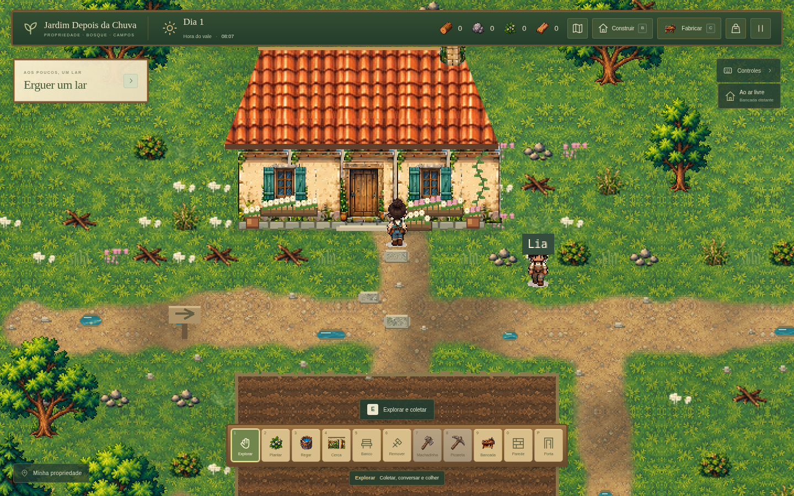

# Recursos e margens renovados

**Estado:** implementação no projeto em desenvolvimento, após os [onze materiais de terreno](terrenos-novos.md). O executável público 0.3.0 continua sendo a entrega anterior; esta etapa não publica outro pacote Windows.

## Imagens para revisão

- [Prancha dos seis sprites finais](capturas/recursos-galeria.png).
- [Pedras soltas e rochas mineráveis no mapa](capturas/recursos-pedras.png).
- [Arbustos e fibras](capturas/recursos-arbustos.png).
- [Margem arredondada](capturas/recursos-margem.png).
- [Travessia da ponte](capturas/recursos-ponte.png).

A propriedade foi capturada após Novo Jogo e caminhada pelo teclado até a porta. As imagens de pedras e arbustos usam posições de partida para mostrar recursos existentes. As aproximações da água e da ponte usam posições de save; a parada na margem e as travessias foram testadas por teclado. A prancha mostra os sprites efetivamente usados pelo jogo.

## Recursos

Um [atlas original de recursos](../public/assets/visual/resources/resource-atlas.png) fornece seis sprites, com cores e pixel art baseadas nas árvores do jogo:

| Recurso | Aparência | Coleta |
| --- | --- | --- |
| Pedras soltas | Pequeno conjunto baixo de seixos claros, 30×20 | À mão |
| Rocha minerável | Formação alta e ancorada, faces angulares, fraturas e musgo, 48×54 | Picareta, cinco golpes |
| Sementes | Arbusto compacto com cápsulas douradas, 36×36 | À mão |
| Fibras | Hastes abertas e folhas compridas, 32×38 | À mão |
| Galhos | Gravetos secos quebrados, 36×24 | À mão |
| Sucata | Chapas dobradas e ferragens, 30×28 | À mão |

O [guia do atlas](../public/assets/visual/resources/README.md) documenta o recorte, as chaves e a integridade da fonte. O arquivo permanece preservado; os sprites preparados em memória recebem alpha limpo e nearest-neighbor. `src/resource-sprites.ts` adapta as células sem deformação, e `src/visual-assets.ts` mantém os assets anteriores como fallback.

## Distribuição e partidas antigas

`src/data/resource-layout.ts` coloca os recursos baixos fora das trilhas, pontes, água, horta, construções e obstáculos. O teste usa o tamanho inteiro do sprite com margem de segurança e o contorno pintado do caminho, além dos tiles lógicos. A decoração baixa da propriedade respeita os mesmos contornos.

Em uma partida nova sem construções, **40 dos 67 recursos baixos** mudam para vagas próximas na mesma região. As **734 árvores** mantêm suas posições. Permanecem **801 recursos**, com os mesmos IDs, tipos e recompensas. Um ID pode continuar contendo a coordenada antiga; a posição atual vem de `ResourceNode.x/y`.

A distribuição considera também os candidatos já esgotados, antes de aplicar a lista do save. Assim, coletar um recurso não muda a vaga dos demais ao carregar novamente. Golpes parciais seguem associados ao ID anterior. Construções salvas têm prioridade: uma vaga ocupada pode levar o recurso a outra posição segura, sem apagar a construção nem conceder materiais. Em uma região completamente ocupada, sem vaga válida, o recurso permanece indisponível sem ser marcado esgotado; ele pode voltar após liberar espaço e recarregar.

## Caminhos e água

`src/data/terrain-shape.ts` calcula contornos em coordenadas mundiais. As trilhas usam segmentos com pontas e junções arredondadas, variação de largura e bordas irregulares. A pintura não é cortada pelo limite retangular dos tiles de caminho.

O campo de distância da água usa elipses para os lagos e uma curva senoidal para o rio, preservando a classificação de todos os centros de tiles existentes. Areia, musgo, rasos e reflexos acompanham essa margem. Os apoios das duas pontes mantêm uma conexão seca com os caminhos, com transição suave nas proximidades.

`WorldView.isBlockedPoint` testa os obstáculos sólidos e a água pela posição real dos pés; `Player` e a recuperação de posição ao carregar usam essa consulta. Colisões de casas, rochas, árvores, construções e Lia permanecem por célula. Construção usa verificações conservadoras da água, para não oferecer um piso atravessando a nova curva da margem. Pisos já salvos em terra original continuam cobrindo pequenos avanços da margem; não liberam obstáculos sólidos nem células de água original. Não há mudança no formato ou na chave do save.

## Verificações

- TypeScript aprovado.
- **123 testes em oito arquivos** aprovados, incluindo layout, esgotamento, mineração parcial, centros da água, continuidade das curvas, apoios das pontes, travessia e movimento junto à margem.
- Build aprovado; permanece o aviso conhecido sobre o tamanho do bundle do Phaser.
- Chromium: seis sprites distintos com alpha apenas 0/255, 801 recursos, 40 realocações, nenhuma pedra/rocha/arbusto/fibra/galho/sucata nas trilhas ou pontes e 45 parcelas preservadas.
- Save v2 anterior: inventário, construções, recursos esgotados e golpes parciais preservados. Pedra coletada à mão; rocha recusou mãos e entregou quatro pedras apenas no quinto golpe de picareta. Recarregar não duplicou recursos nem recompensas.
- Movimento por teclado: parada na margem com os pés fora da água e travessia das duas pontes. Menus pausaram posição e relógio. Um piso salvo em terra original manteve a passagem sob um pequeno avanço da margem; um piso em célula originalmente aquática não liberou a água.
- Nenhum erro de JavaScript ou carregamento de assets registrado nesse fluxo.

Abra a versão de desenvolvimento com `npm run dev`. Os recursos têm posições fixas e não renascem por tempo; não foi introduzido um sistema de respawn. A água continua estática. O arredondamento preserva a pixel art e a estrutura do mapa existente.
