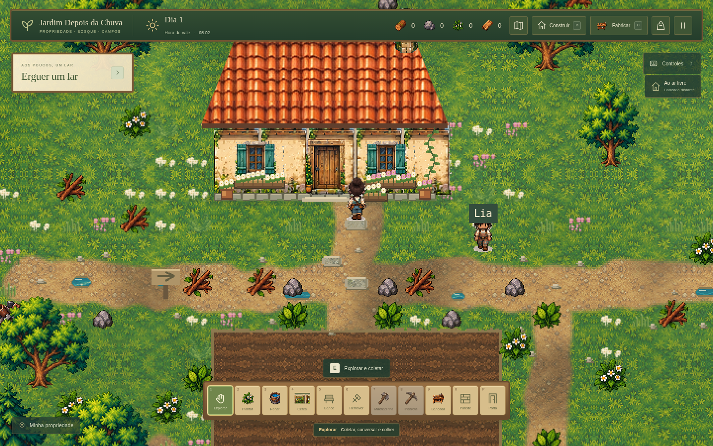

# Reformulação dos sprites de terreno

**Estado:** aplicada ao mesmo projeto e incluída no [executável Windows 0.4.0](versao-windows-v0.4.md). Os checks abaixo registram esta etapa de desenvolvimento após a versão 0.3.0, mantendo Phaser 3, mapa e sistemas existentes.

Este documento registra o primeiro lote dos pisos. A [etapa seguinte de recursos e margens](recursos-e-margens.md) acrescenta recursos redesenhados, realocação para fora das trilhas e contornos contínuos de água e caminhos, com novas verificações.

Os novos atlas locais de [terreno](../public/assets/visual/terrain/ground-materials.png) e [acabamentos](../public/assets/visual/terrain/floor-finishes.png) foram criados usando as árvores do jogo como referência de pixel art, cores e iluminação. Fornecem onze materiais: grama da propriedade, chão de bosque, grama dos campos, estrada seca, estrada úmida, solo cultivado, areia de margem, musgo úmido, água, tábuas e pedra de passagem. A [documentação dos atlas](../public/assets/visual/terrain/README.md) registra células, chaves, escala, SHA-256 e limitações.

## Capturas reais

As capturas mostram a arte renderizada pelo jogo. A propriedade foi capturada após criar uma partida e caminhar até a porta. As demais imagens usam posições carregadas de partidas de teste para inspecionar cada região.



- [Bosque](capturas/terreno-bosque.png).
- [Campos](capturas/terreno-campos.png).
- [Margem e água](capturas/terreno-margem.png).
- [Tablado da ponte](capturas/terreno-ponte.png).
- [Pisos construídos em uma partida de teste](capturas/terreno-piso-construido.png).
- [Onze sprites preparados para o jogo](capturas/terreno-materiais.png).

## Adaptação e escopo

- `src/terrain-sprites.ts` recorta onze sprites de 96×96, com nearest-neighbor. Ajusta a cor média e o contraste por material para manter personagem, recursos e copas legíveis, preservando os PNGs-fonte.
- `src/terrain-art.ts` aplica os sprites e mistura as transições por coordenadas do mundo. A estrada varia entre terra seca e úmida; margens e regiões recebem materiais próprios. A amostragem espelhada reduz emendas no solo. A água usa bordas preparadas para repetição e deslocamentos suaves, preservando a direção das ondas.
- Pequenas poças usam o sprite de água. Os tufos procedurais repetidos da antiga camada-base são usados apenas no fallback; a decoração baixa da propriedade permanece separada.
- `src/visual-assets.ts` carrega o atlas local e prepara os materiais. `src/world.ts` compõe uma única textura estática de 3072×2304 e a reutiliza entre carregamentos.
- `src/art.ts` usa a nova madeira no piso construído de 32×32. A mesma madeira cobre o tablado das duas pontes; a nova pedra reveste as três pedras de passagem maiores até a porta da casa.

As posições e regras de recursos, caminhos, horta, água bloqueada, pontes e construções continuam definidas pela geometria existente. O formato e a chave do save permanecem iguais. Armações das pontes, pequenas pedras decorativas e demais objetos mantêm sua arte anterior. A água deste conjunto é estática.

## Validação

A comparação com a tag `v0.3.0` confirmou os mesmos **801 recursos** e os mesmos estados de colisão, cultivo e construção nas **6.912 células** do mapa.

- `npm run check`: aprovado.
- `npm test`: **104 testes aprovados em seis arquivos**.
- `npm run build`: aprovado; permanece o aviso conhecido sobre o tamanho do bundle do Phaser.
- Chromium: onze sprites distintos e opacos de 96×96, terreno final totalmente opaco, 45 parcelas sem decoração sobreposta, uma camada de terreno e uma de decoração, cache mantido entre carregamentos e Continuar, resultado determinístico após recarregar e nenhum erro de JavaScript ou asset. O piso construído é opaco, tem 32×32 e coincide pixel a pixel com a redução nearest do novo material de madeira. Um save de teste com nove pisos mostrou a renderização na camada correta.
- A propriedade também foi conferida após criar uma partida e caminhar pelo teclado até a porta. As capturas das outras regiões usam posições de save para inspeção; não representam uma nova travessia a pé do mundo inteiro.
- Build final servido pelo Vite Preview: os dois atlas responderam com sucesso, Novo Jogo, movimento e salvamento passaram, sem erros de JavaScript ou assets. No fluxo de produção desta etapa também passaram migração v1 com backup, colheita, plantio, rega, cerca, banco, pausa e conversa com Lia.

Um diagnóstico isolado no Chromium headless Linux mediu aproximadamente **949 ms** para uma pintura do terreno inteiro com os onze materiais. A medição exclui leitura dos sprites, upload à GPU e criação das entidades; não mede FPS, VRAM ou desempenho no Windows. A pintura acontece na criação da textura e é reutilizada durante a caminhada e ao carregar partidas na mesma sessão.

Materiais repetidos ainda podem ser reconhecidos em áreas extensas, e ondas cruzadas pertencem ao desenho do sprite de água. Não houve teste interativo desta alteração no Windows nativo nem geração de outro executável.

Para abrir a versão de desenvolvimento:

```bash
npm ci
npm run dev
```

Use o endereço indicado pelo Vite. `npm run check`, `npm test` e `npm run build` conferem o projeto. Esta etapa não publica um novo executável.
