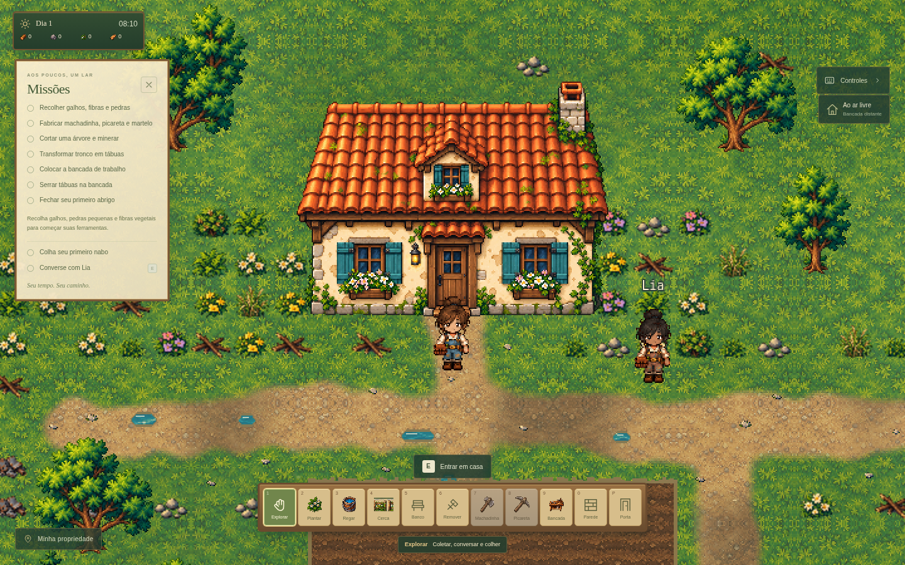

# After Rain 0.5.0 — Windows x64

Esta versão reúne todas as alterações implementadas depois da entrega 0.4.0. O pacote portátil destina-se ao Windows 10/11 de 64 bits, incluindo Windows 11 x64. Continua no mesmo projeto, com Phaser 3, Vite e Electron.

## Conteúdo

- Nome **After Rain** e tela inicial com garoa, neblina, câmera suave e controle do fundo. O vídeo do Flow ainda não foi fornecido; a abertura usa o cenário animado do jogo.
- Sprite original da casa, detalhada no estilo das árvores e do terreno atuais. Acesso de terra centralizado na porta.
- Interior personalizável com seis tipos de móvel, três pisos e três paredes. Acervo gratuito nesta etapa, limites e validação de circulação. Posição e decoração persistem.
- Cama para descansar das 19:00 às 07:59 e acordar às 08:00. O sono avança o calendário e os cultivos regados, sem regar os secos.
- Barra superior retrátil: seta revelada ao passar o mouse no centro superior, ou botão direito no cenário. Acesso a inventário, mapa, fabricação, construção, salvar e opções. Barra e menus abertos pausam a simulação.
- Missões com **X** para fechar o painel inteiro, botão discreto para reabrir e preferência lembrada localmente.
- Informações de dia/hora/recursos em cartão de **210×62 px**.
- Seis placas externas retiradas. Nome da Lia sem retângulo de fundo.
- Painel de administração por senha para buscar e conceder os 19 itens implementados. Minimizar permite testar no mapa; encerrar ou sair da partida revoga a sessão. A senha foi entregue separadamente e não está no repositório.
- Mantém propriedade, Bosque do Pinheiro, Campos Abertos, personagem/editor, coleta, cultivo, NPC, ferramentas, corte/mineração, processamento de madeira, construção e saves anteriores.

## Distribuição

Preparação da Release **v0.5.0** por meio de `.github/workflows/windows-release.yml`. O executável tem nome `After-Rain-0.5.0-Windows-x64.exe`; o workflow gera o aplicativo em um runner Windows e produz `SHA256SUMS.txt`.

O local do save permanece `%APPDATA%\Depois da Chuva`, com appId `br.depoisdachuva.jogo`, origem `chuva://jogo`, chave `depois-da-chuva-v1` e formato versão 2. A mudança de nome para After Rain não cria uma nova pasta de saves. O save do navegador é separado do save do aplicativo.

O pacote roda offline e não exige Node.js, servidor nem instalação. A execução interativa no Windows nativo não foi realizada neste ambiente Linux. O próximo polimento visual da HUD será feito depois desta entrega e não integra este pacote.
