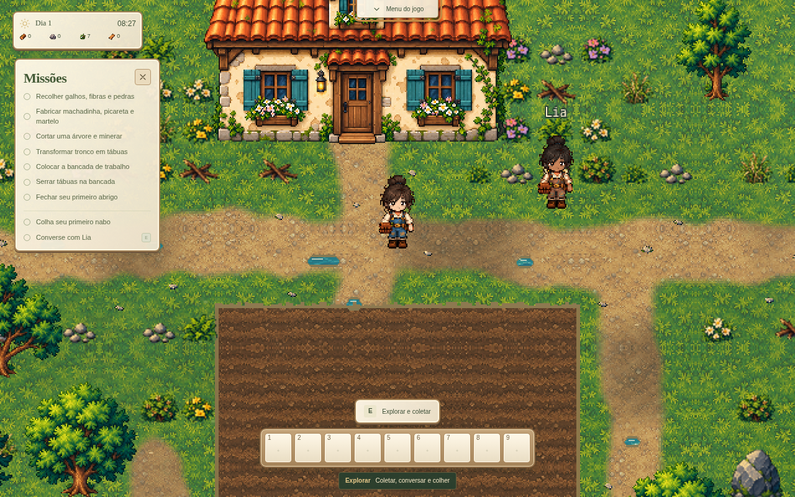
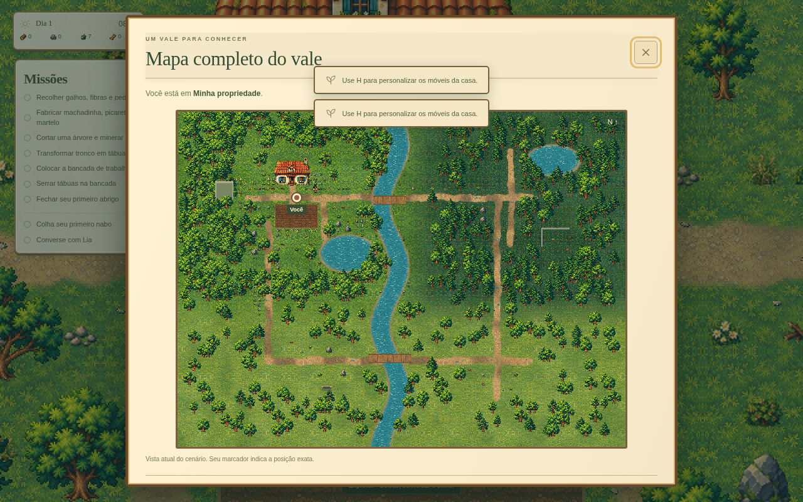

# After Rain 0.6.0 — Jardim leve

Continuação da branch `title-screen-0.5`, sobre `4648e371` (0.5.1). O ambiente recebido continha apenas a cópia limpa da main 0.1.0. Não foram encontrados arquivos locais da 0.6.0, stash ou objetos Git recuperáveis; o caminho do ambiente anterior não estava disponível. A branch existente foi buscada e as melhorias foram implementadas sobre ela, sem recriar o projeto ou substituir assets.

## Como usar

- Nove slots começam vazios. Clique em um slot ou pressione seu número para escolher uma ação. Botão direito troca ou esvazia; 1–9 seleciona a ação atribuída. Ferramentas precisam ser obtidas e construções continuam exigindo seus custos. As escolhas ficam no save da partida.
- Dentro da casa, aproxime-se do regador ou das sementes no chão e pressione E. Cada objeto pode ser recolhido uma vez; o pacote entrega exatamente 7 sementes. O regador é uma posse permanente, registrada separadamente do estoque consumível.
- Arraste o cabeçalho Missões para reposicionar. X fecha, Missões reabre. Posição e visibilidade são preferências locais, limitadas à janela.
- M mostra uma captura atual de todo o cenário externo jogável (96×72 tiles), com o marcador em coordenadas contínuas do personagem. Dentro da casa mostra **Interior da casa** (12×10 tiles). Ao sair, M volta ao mapa externo. Construções e recursos visíveis entram na captura; o mapa não usa a ilustração conceitual.
- O nome da área aparece por 10 segundos ao entrar ou mudar de local. Controles ficam na barra superior. O cartão “Ao ar livre” foi removido; a detecção de abrigo permanece funcionando.
- H é a única entrada para personalização. E coleta/interage, entra/sai e usa a cama. B continua a construção externa.

## Persistência e compatibilidade

A chave, origem do aplicativo e versão do schema permanecem iguais. `quickbar` e `homeSupplies` são extensões opcionais validadas. Saves anteriores continuam carregando e recebem slots vazios; podem recolher os dois novos objetos. Cada coleta registra ambos os estados booleanos independentemente da ordem. Capacidade insuficiente não consome o pacote.

## Validação

- `npm run check`, `npm test` (167 testes) e `npm run build`.
- Chromium com Playwright: regador→sementes e sementes→regador; salvar e recarregar após **cada** objeto; verificar estoque, flags, ausência dos objetos e impedir segunda recompensa.
- Teclado E/H, atribuição/remoção de slots, persistência, arrastar/fechar/reabrir missões, 10 segundos da localização, controles na barra.
- M no interior e após sair, dimensão integral do mapa e marcador proporcional à posição real.
- Inspeção visual em 1920×1080, 1280×800, 960×640 e 390×844. Sem erros JavaScript ou assets nesse fluxo.
- O build apresenta o aviso já existente de chunk grande por incluir Phaser.

O workflow existente gera o portátil em runner Windows x64, repete checks/testes e publica o executável com SHA-256. Não foi realizado teste interativo em Windows 11 neste ambiente Linux.

A automação usada fica em `scripts/qa-hud.cjs`. Com Vite rodando, Playwright instalado no ambiente de QA e Chromium disponível, execute `node scripts/qa-hud.cjs`. Variáveis opcionais: `CHROMIUM_PATH`, `QA_URL` e `QA_OUTPUT`. O script usa acesso à cena para preparar posições, interage por teclado/mouse e recarrega a página entre coletas. Ele depende do servidor de desenvolvimento para inspecionar o módulo da cena; não é um teste do executável Windows.

